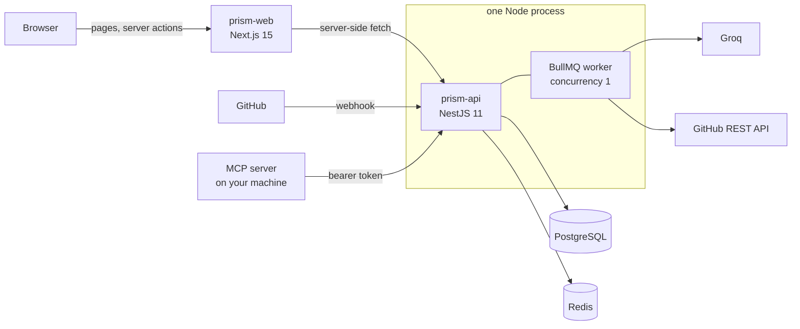

<div align="center">

# PRism

**An AI code reviewer for GitHub that shows its work.**

Every finding points at a line that really changed. Every review opens with a verdict you
can check, not a score you have to trust.

[**Try it live**](https://prism-web-fgts.onrender.com/login) · [Documentation](docs/README.md) · [MCP server](mcp-server/README.md)

[](https://github.com/Muhammad-AIUB/PRISM/actions/workflows/ci.yml)
[](LICENSE)

<sub>The live demo runs on Render's free tier. After an idle spell the API takes about 40 seconds to wake,
and the app shows a waiting page while it does.</sub>

</div>

---

## What it does

Connect a repository and PRism reviews every pull request and every push to the branches
you choose. For each one it:

1. Receives the GitHub webhook and verifies its HMAC signature.
2. Fetches the diff with the repository owner's own token, and picks the files and hunks
   that fit the model's budget.
3. Asks Groq (Llama 3.3 70B, falling back to Llama 3.1 8B) to review the change for
   security, performance and code-quality problems.
4. **Checks every finding against the diff.** The model sees an anchor per changed line;
   a finding whose anchor does not resolve is dropped instead of shown at a guessed
   line.
5. Reduces what survived to a **verdict**: *blocking*, *worth a look*, *nothing found*, or
   *not reviewed* when no model produced an answer.
6. Asks the model for concrete `before -> after` fixes, and drops any whose quoted code is
   not where it claims to be.
7. Scores the change's blast radius with **Risk Radar**, which is deterministic and needs
   no model.
8. Posts one summary comment on the pull request or commit, and optionally a Slack message.

The same reviews are available in a dashboard, as a PDF export, and inside your editor
through an [MCP server](mcp-server/README.md).

### Risk Radar

A 0-100 change-risk score built from where a change lands: auth code, migrations,
hardcoded secrets, missing or removed tests, CI and deploy config, dependencies, public
API. It comes with a short "before merging" checklist triggered by what the added lines
do: a network call with no timeout, string-built SQL, a swallowed error, a migration with
no way back. It is a pure function of the diff, so it works when the AI is down.
[More](docs/risk-radar.md).

### Design Studio

Describe what you are building, pick a scale and up to four priorities, and get a system
design sized to that load: components, request flow, failure modes with mitigations, SLOs,
a scaling plan with numeric triggers, trade-offs and a production-readiness checklist.
Export it as Markdown, or ask for it from your editor. [More](docs/design-studio.md).

## How it fits together



The browser only ever talks to `prism-web`. The API origin, the session cookie and the
user's GitHub token never reach client JavaScript. The review worker runs inside the API
process because Render's free tier has no background-worker service type. Read
[docs/architecture.md](docs/architecture.md) for the reasoning.

## Repository layout

| Path | What it is |
|---|---|
| [`prism-api/`](prism-api/README.md) | NestJS 11: REST API, GitHub webhook, session and token auth, the BullMQ review worker |
| [`prism-web/`](prism-web/README.md) | Next.js 15 App Router frontend. All data is fetched on the server |
| [`mcp-server/`](mcp-server/README.md) | MCP server exposing reviews, Risk Radar and Design Studio to AI editors |
| [`docs/`](docs/README.md) | Architecture, reference, how-to guides, runbook, decision records |
| `render.yaml` | Render deployment for both services |
| `.github/workflows/` | CI, and a keep-alive ping for the free tier |

## Run it locally

You need Node 22.12 or newer, Docker, and a GitHub OAuth app. The short version:

```bash
# Postgres 16 and Redis (noeviction is required), then the schema
docker run -d --name prism-pg -e POSTGRES_USER=prism -e POSTGRES_PASSWORD=prism \
  -e POSTGRES_DB=prism -p 55432:5432 postgres:16-alpine
docker run -d --name prism-redis -p 56379:6379 redis:7-alpine \
  redis-server --maxmemory-policy noeviction
docker exec -i prism-pg psql -U prism -d prism -v ON_ERROR_STOP=1 < prism-api/schema.sql
```

Then configure and start the two servers as described in
[docs/development.md](docs/development.md). That guide also covers the GitHub OAuth app,
sending a signed test webhook without a tunnel, and the pitfalls that cost people an
afternoon.

## Documentation

| If you want to... | Read |
|---|---|
| Understand the system | [Architecture](docs/architecture.md), [Review pipeline](docs/review-pipeline.md) |
| Run or change it | [Development](docs/development.md), [Testing](docs/testing.md), [Contributing](CONTRIBUTING.md) |
| Look something up | [API reference](docs/api-reference.md), [Configuration](docs/configuration.md), [Database](docs/database.md) |
| Deploy and operate it | [Deployment](docs/deployment.md), [Operations runbook](docs/operations.md) |
| Judge the security | [Security](docs/security.md), [SECURITY.md](SECURITY.md) |
| Know why it is built this way | [Decision records](docs/adr/README.md) |
| See what is broken today | [Known issues](docs/known-issues.md) |

## Status and limits

PRism works end to end and has no outside users yet. Be aware of these before you rely on
it:

- **One AI provider.** Groq's free tier, two models. When both are rate-limited the attempt
  is retried (60 s, then 180 s); after the third failure the review is marked failed.
- **Language rules** exist for PHP, JavaScript and TypeScript, Python and Go. Ruby and Java
  are detected but get no language-specific rules.
- **The model sees roughly 8,000 characters of a diff**, chosen whole file first, then
  whole hunk. Every review states how much of the change it covered.
- **Free-tier hosting** means cold starts, and a webhook that arrives while the API sleeps
  may be lost. See [known issues](docs/known-issues.md).

## License

[MIT](LICENSE). Built by [Muhammad Jubayer](https://www.mjubayer.dev/)
([GitHub](https://github.com/Muhammad-AIUB)).
