# PRism App Flow

Status: describes how people and systems move through PRism as built at `3ae7b5f`
(2026-10-26). Screen layouts are in [Ui-spec.md](Ui-spec.md); endpoint details are in
[trd.md](trd.md).

Related: [PRD](PRD.md) · [UI spec](Ui-spec.md) · [TRD](trd.md) · [Schema](schema.md) · [Plan](plan.md)

---

## 1. Actors

| Actor | Talks to | How |
|---|---|---|
| **Visitor / user** (browser) | `prism-web` only | Pages and server actions. The one exception is `/waking`, where the browser pings the API directly. |
| **prism-web** (Next.js) | `prism-api` | Server-side fetches from React Server Components and Server Actions, forwarding the session cookie and `X-Request-Id`. |
| **GitHub** | `prism-api` | OAuth redirects, webhooks to `/webhook/github`. PRism calls GitHub's REST API for repos, branches, diffs, hooks and comments. |
| **MCP client** (Claude Code, Cursor…) | `prism-api` `/api/v1` | Bearer API token, through the `prism-code-review-mcp` server on the developer's machine. |
| **Groq** | — | Called by `prism-api` for reviews, fixes and designs. |
| **Slack** | — | Receives a message per completed review when configured. |

Both services answer on **one hostname**. `prism-web` rewrites `/auth/*`, `/api/v1/*`
and `/webhook/*` to the API, so the session cookie the API sets is first-party for every
page.

---

## 2. Site map

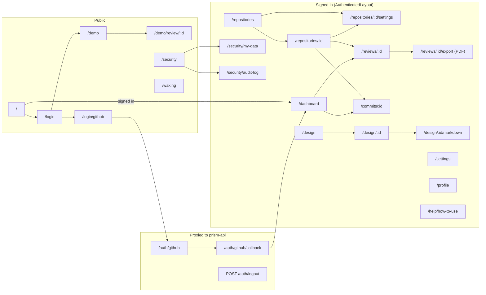

### Route table

| Path | Access | Purpose |
|---|---|---|
| `/` | public | Redirects to `/dashboard` if signed in, else `/login` |
| `/login` | public | Sign-in card, demo link, permissions disclosure. Shows `?error=` and `?status=` |
| `/login/github` | public (route handler) | Checks the API is awake, then hands over to `/auth/github` |
| `/waking` | public | Wakes a sleeping API from the browser, then returns to `?next=` |
| `/demo`, `/demo/review/:id` | public | Sample data, no session |
| `/security` | public, session-aware | Security & Privacy explainer; extra actions when signed in |
| `/dashboard` | session | Stats, score timeline, latest PR and commit reviews |
| `/repositories` | session | GitHub repos, connect with a review mode |
| `/repositories/:id` | session | All reviews for one repository (`?kind=prs\|commits&page=n`) |
| `/repositories/:id/settings` | session | Review mode and watched branches |
| `/reviews/:id` | session | PR review (`:id` is the pull request row id) |
| `/reviews/:id/export` | session (route handler) | PDF download |
| `/commits/:id` | session | Commit review |
| `/design` | session | Design Studio form and saved designs |
| `/design/:id` | session | Blueprint |
| `/design/:id/markdown` | session (route handler) | Markdown download |
| `/settings` | session | Slack webhook, API tokens |
| `/profile` | session | Name and email |
| `/security/my-data` | session | Everything stored, delete everything |
| `/security/audit-log` | session | Activity timeline |
| `/help/how-to-use` | session | Guide and FAQ |

Signed-out access to any session page redirects to `/login` (the PDF and Markdown
download routes return the API's JSON error instead). The original URL is not kept, so
after sign-in the user lands on `/dashboard`.

---

## 3. Sign in

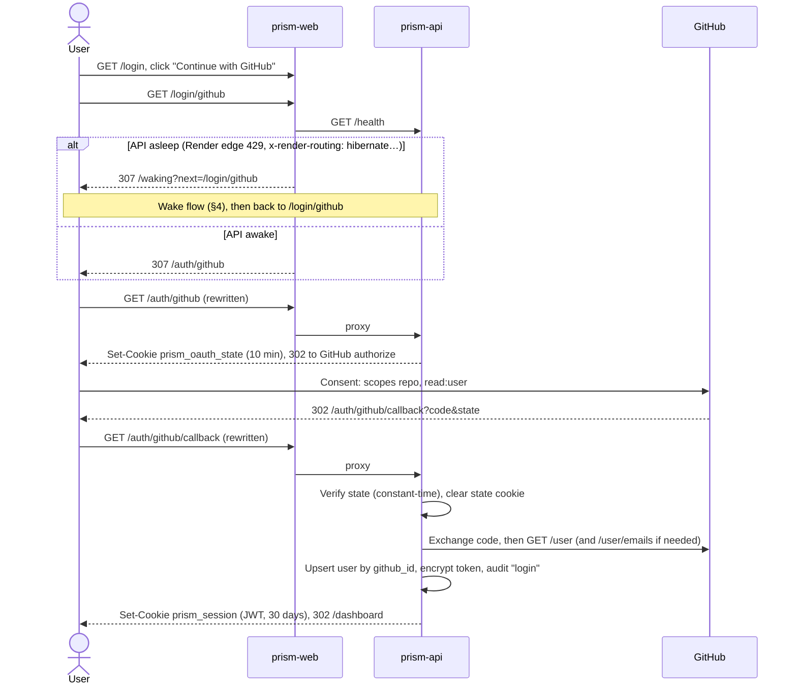

- **Failure:** any error in the callback redirects to
  `/login?error=GitHub sign-in failed: <message>`.
- **Throttle:** `/auth/github` and the callback allow 10 requests per minute.
- **Already signed in:** `/login` does not redirect away; `/` does.

---

## 4. Waking a sleeping API

On Render's free tier `prism-api` sleeps after 15 idle minutes. While it sleeps,
Render's edge answers requests from `prism-web` with a 429 carrying
`x-render-routing: hibernate-rate-limited` and **does not start the service**. Only a
request from outside Render wakes it.

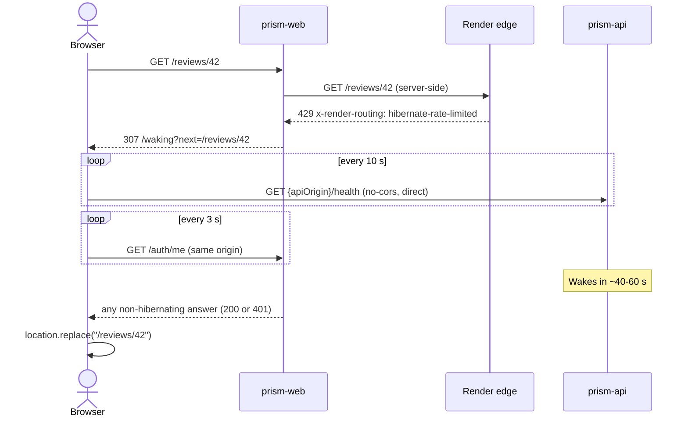

- `next` must be a same-site path; anything else falls back to `/dashboard`.
- After 90 s the page adds "This is taking longer than usual." and a "Try again" link.
- **Server actions never redirect.** An action that finds the API asleep returns the
  message "The server was asleep. Reload this page to wake it, then try again."
- `/waking` is the only page whose CSP `connect-src` allows the API origin.

---

## 5. First use: connect a repository

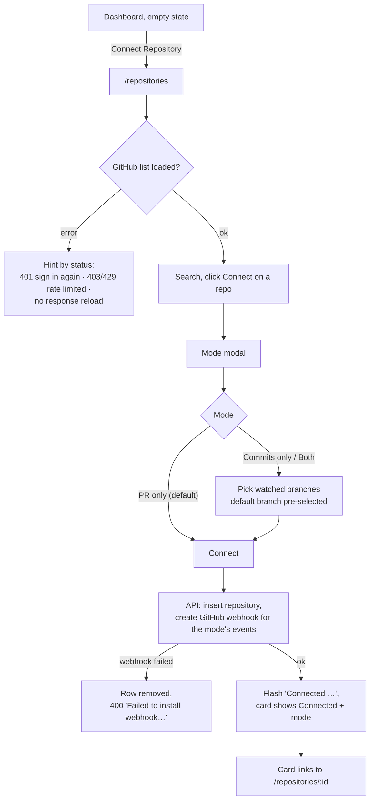

Mode → webhook events:

| Mode | GitHub events | Reviews |
|---|---|---|
| `pr_only` | `pull_request` | PR opened or synchronized |
| `commit_only` | `push` | Pushes to watched branches |
| `both` | `pull_request`, `push` | Both |

**Changing settings** (`/repositories/:id/settings`) saves the mode and branches and
updates the webhook's events. If the GitHub update fails it is only logged, so the hook
can keep sending events the new mode does not want. Leaving branches empty means
`main` and `master`.

There is no disconnect. A repository stays connected until the account is deleted.

---

## 6. Automatic review

### 6.1 Webhook intake

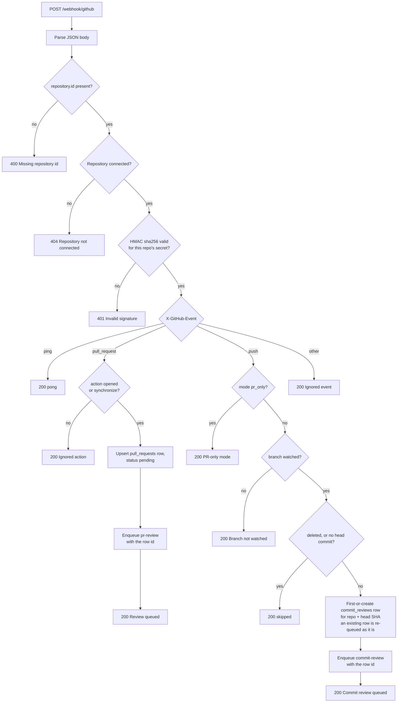

- Only the head commit of a push is reviewed.
- PR events are not checked against mode or branches; the webhook subscription is the
  only gate.
- The webhook route allows 60 requests per minute.

### 6.2 Job processing

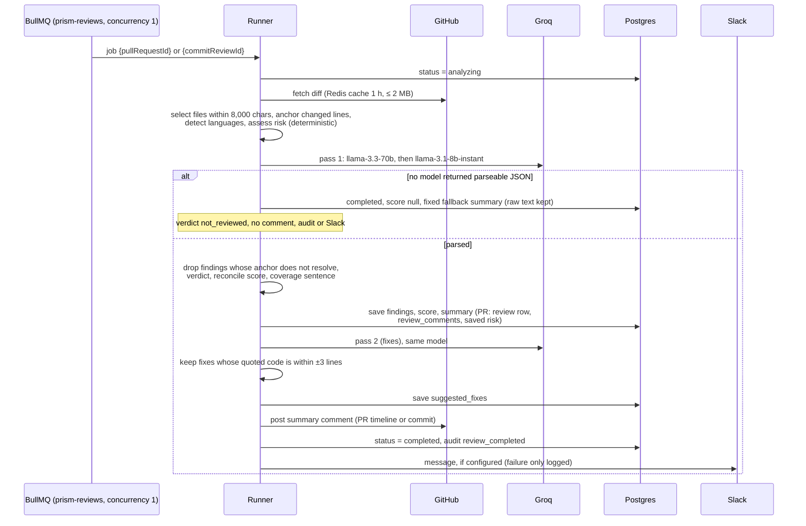

Each attempt has a 270-second budget. When it runs out, an `AbortController` cancels
every in-flight call, and the runner checks it before saving results and before posting,
so a timed-out attempt never posts a comment.

### 6.3 Status lifecycle

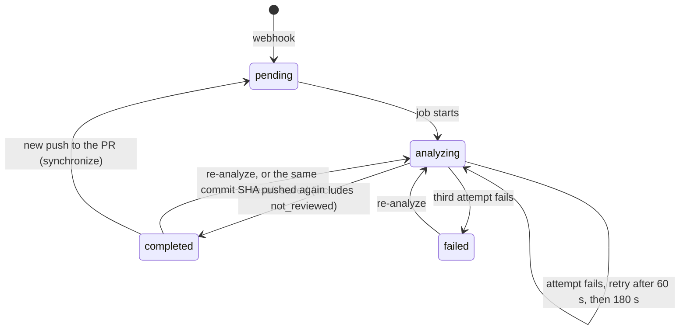

The review and dashboard pages poll while anything is `pending` or `analyzing`
(review pages every 5 s, dashboard and repository pages every 8 s).

---

## 7. Reading a review

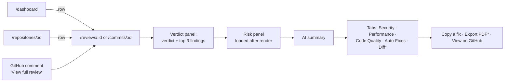

`*` PR reviews only. Reading order is deliberate: verdict first, then how risky the
change is, then detail.

- A review id the user does not own, or that does not exist, shows the same 404 page.
- The verdict is computed when the page is read, so legacy reviews (before 2026-09-14)
  get a panel too. On a commit review the panel also renders while the review is
  pending, analyzing or failed, where it wrongly reads "Nothing found"
  ([Ui-spec.md](Ui-spec.md#11-known-deviations) D31).

---

## 8. Re-analyze

| From | What happens before the new job runs |
|---|---|
| PR page (web) | Status `analyzing`; the old review and its comments are **deleted**; saved risk forgotten |
| Commit page (web, failed reviews only) | Status `analyzing`; score, summary, findings and fixes cleared; diff cache forgotten |
| MCP / `/api/v1` PR | Status `analyzing`; the old review **stays visible** until the new one lands |
| MCP / `/api/v1` commit | As the web commit path |

Each re-analyze enqueues a new job and writes a `review_reanalyzed` audit entry. Clicking
twice enqueues twice (no de-duplication).

---

## 9. Design Studio

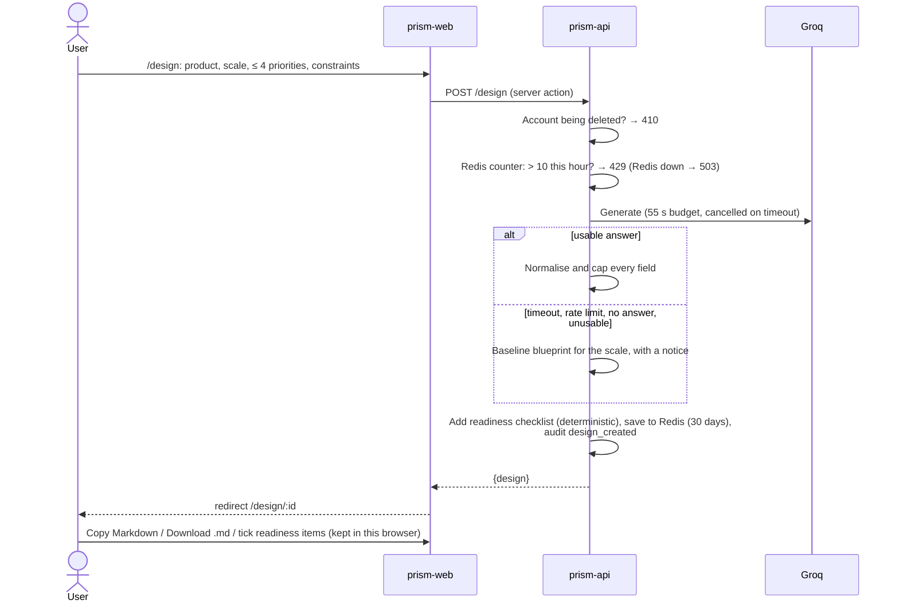

From an editor the same thing happens through MCP `design_system`, which returns the
blueprint as Markdown; `get_design` lists or fetches saved designs.

---

## 10. API tokens and MCP

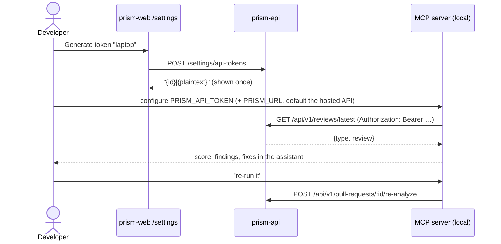

Revoking a token in Settings stops it immediately. Every token failure is a 401 with the
body `{"message":"Unauthenticated."}`; rate limiting is a 429 with
`{"message":"Too Many Attempts."}`. The MCP server shows them as
`PRism API 401: {…}`.

---

## 11. Settings, data and sign-out

**Slack:** paste an `https://hooks.slack.com/…` URL, Test (sends a test message and shows
Slack's answer), Save. Clearing the field turns notifications off.

**My Data → delete everything:**

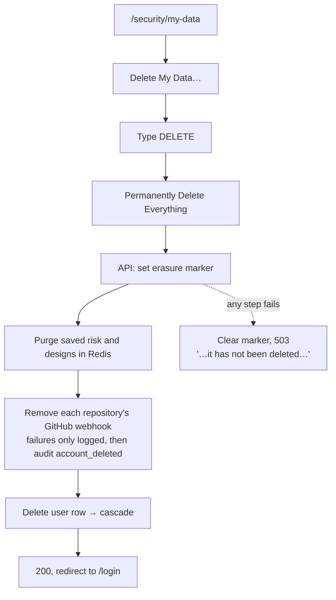

**Profile → delete account** asks for a password that GitHub users do not have; the page
sends them to My Data instead.

**Sign out:** user menu → Log out → `POST /auth/logout` (revokes the JWT in Redis until
it would expire, clears the cookie) → `/login`.

---

## 12. Error handling, as the user sees it

| Situation | Page load (RSC) | Server action |
|---|---|---|
| Not signed in / session revoked (401) | Redirect to `/login` | `ok: false`, message "Unauthenticated." |
| Not yours, malformed id, missing (400/403/404) | 404 page: "does not exist, or it belongs to another account" | `ok: false` with the API message |
| Validation (422) | — | `ok: false`, field errors under the inputs |
| Rate limited (429) | GET retried once if the wait is ≤ 5 s, otherwise error | `ok: false`; Design Studio shows "You have generated a lot of designs this hour…" |
| API asleep | Redirect to `/waking?next=…` | 503 "The server was asleep. Reload this page to wake it, then try again." |
| Anything else (5xx) | Error boundary: "Something went wrong", digest, Try again | `ok: false` with a fallback message |

Gaps in these paths (actions with no `.catch`, raw JSON from the PDF route on failure)
are listed in [Ui-spec.md §11](Ui-spec.md#11-known-deviations).

---

## 13. Demo

`/login` → "Explore Demo" → `/demo` (sample dashboard) → `/demo/review/:id` (sample
review with Issues and Auto-Fixes tabs). Every demo navigation item except Security &
Privacy (the real `/security`) leads back to `/demo`; "Sign in with GitHub" leads to
`/login`. Nothing in the demo calls GitHub or
writes data.
