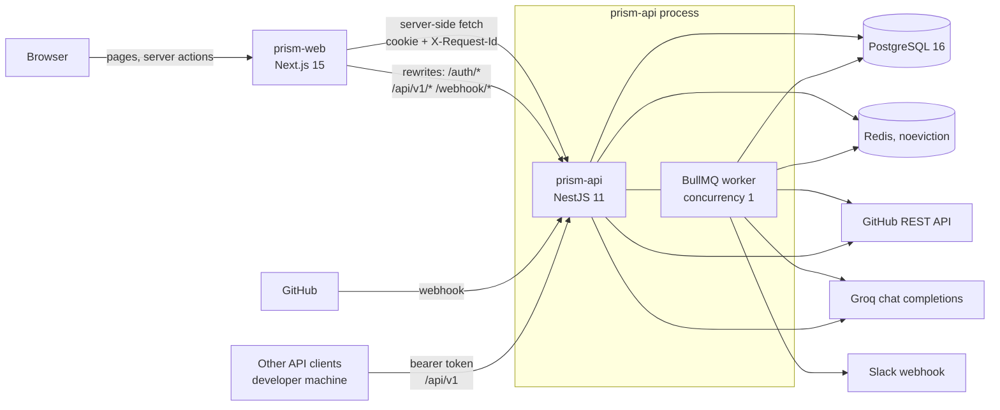

# Architecture

This page explains how PRism is put together and why. It is the document to read before
changing anything that crosses a package boundary. For field-level detail see the
[API reference](api-reference.md), [database](database.md) and
[configuration](configuration.md) pages; for the life of one review see the
[review pipeline](review-pipeline.md).

## The shape of the problem

Three facts shaped almost every decision in this codebase:

1. **It was designed for free tiers.** The original Render deployment had 512 MB of memory and
   no background-worker type. Production is now `prism-api` on a VPS and `prism-web` on
   Vercel, but the limits below still shape the code. Postgres is on Neon and Redis on Upstash.
2. **It inherited production data.** The database, its schema, the encrypted GitHub tokens
   and the API tokens in MCP users' config files were all written by an earlier PHP
   application. The code was rewritten; the bytes were not. See
   [ADR 0001](adr/0001-keep-the-stored-formats.md).
3. **Its output is judged by whether a reader trusts it.** One wrong line number costs more
   trust than ten correct findings earn. So the pipeline validates what the model says
   against the diff before showing it. See [ADR 0006](adr/0006-validate-findings-against-the-diff.md).

## System context

| Component | Responsibility | Runs where |
|---|---|---|
| `prism-web` | Renders every page. Calls the API from the server only. Owns the CSP and the theme | Vercel |
| `prism-api` | HTTP API, webhook intake, session and token auth, the review worker, Risk Radar, Design Studio | A VPS |
| PostgreSQL 16 | Users, repositories, pull requests, reviews, commit reviews, comments, tokens, audit log | Neon |
| Redis | The review queue, caches, saved risk, Design Studio blueprints, session revocations, erasure markers | Upstash (must be `noeviction`) |
| Groq | The only AI provider | External |
| GitHub | OAuth, REST API (diffs, comments, webhooks), webhook deliveries | External |

## Two decisions to understand first

### 1. The browser never talks to the API

Every API call is made on the server, from a React Server Component or a Server Action,
through [`prism-web/src/lib/api.ts`](../prism-web/src/lib/api.ts). That function reads the
session cookie from the incoming request and forwards it. As a result the API origin, the
session token and the user's GitHub token never reach client JavaScript, and
`PRISM_API_ORIGIN` deliberately has no `NEXT_PUBLIC_` prefix.

The price is that the two services must look like **one origin** to the browser.
`prism-api` sets the session cookie, and a browser returns a cookie only to the origin
that set it. `next.config.mjs` therefore rewrites `/auth/:path*`, `/api/v1/:path*` and
`/webhook/:path*` to the API, in every environment. If that breaks, sign-in appears to work
and every later request is anonymous. See [ADR 0004](adr/0004-server-side-api-access-on-one-hostname.md).

### 2. The review worker lives in the API process

`ReviewProcessor` is a BullMQ worker registered in the same Nest application that serves
HTTP. There is no separate worker deployment (the original host offered none), and
`concurrency: 1` is what keeps peak memory inside 512 MB. The cost is that the worker
cannot scale independently, and a review in progress shares the event loop with requests.
Design Studio, which also calls Groq, runs inline on its HTTP request for the opposite
reason: a design queued behind three reviews would wait minutes. See
[ADR 0002](adr/0002-review-worker-in-the-api-process.md).

## prism-api internals

`prism-api/src` is organised by concern, not by layer.

| Directory | Contents |
|---|---|
| `main.ts`, `app.module.ts` | Boot order, global pipes, filters, helmet, TypeORM and BullMQ wiring |
| `modules/` | One folder per HTTP surface: `api-v1/reviews`, `auth`, `dashboard`, `demo`, `design`, `health`, `profile`, `repositories`, `reviews-web`, `security`, `settings`, `webhook`, plus `review` (queue, processor, runners), `risk` and `account` |
| `ai/` | Groq client, prompt builder, JSON extraction, finding and fix validators, the verdict |
| `diff/` | Pure diff code: hunk index, anchor rendering, file selection, language detection, Risk Radar |
| `design/` | Design Studio's blueprint types, prompt, normaliser, deterministic baseline and Markdown renderer |
| `database/` | TypeORM entities, the `bigint` transformer, the pg type parsers, row mappers |
| `github/` | The GitHub REST client: diffs, comments, webhooks, repository lists |
| `cache/`, `redis/` | The Redis client and the read-through caches |
| `auth/` | API-token guard and token service (the `/api/v1` mechanism) |
| `common/` | Exception filter, rate-limit guard, request-id middleware and logger, crypto, ISO-8601 helpers |
| `notifications/` | Slack |
| `audit/` | The audit log writer |

`diff/` and the validators in `ai/` are deliberately free of Nest and I/O so that they can
be tested exhaustively with plain inputs. Anything that talks to the network or a store is
a Nest provider that tests replace with a fake.

## Cross-cutting behaviour

### Authentication

Two mechanisms run side by side. Browser traffic carries an `httpOnly` JWT cookie signed
with `JWT_SECRET`; `WebAuthGuard` verifies it, checks it has not been revoked, and loads the
user row. `/api/v1` carries a bearer token of the form `{id}|{plaintext}`; the database
stores only `sha256(plaintext)`. The details, and what each one trusts, are in
[security.md](security.md).

### Rate limiting

A global `RateLimitGuard` (100 requests per minute by default) runs before either auth
guard. For that reason it verifies the session cookie itself and keys signed-in browser
traffic per user; everything else is keyed by IP. Every browser request reaches the API
from `prism-web`'s single address, so keying them by IP would put the whole site in one
bucket. Counters live in process memory. Specific routes override the limit: the webhook
(60 per minute) and the OAuth routes (10 per minute). Design generation has its own
per-user hourly limit in Redis.

### Observability

Every API request gets an `X-Request-Id`, kept if the caller sent a safe one. It is held in
`AsyncLocalStorage` and stamped on every log line, and inside the worker the job id takes
its place. In production each line is one JSON object. `prism-web` assigns an id per render
and forwards it, so a page and every API call it made share one id.
[operations.md](operations.md) shows how to follow one.

### Error handling

`ApiExceptionFilter` renders every failure as `{message}`, or `{message, errors}` with a 422
for validation. A 401 body is exactly `Unauthenticated.` and a 429 body exactly
`Too Many Attempts.`; clients match on both. Unexpected exceptions become a 500
`Server Error` with the stack logged and not returned.

## What happens when something fails

| Failure | Behaviour |
|---|---|
| **Groq returns 429 for every model** | The attempt throws; BullMQ retries after 60 s, then 180 s. After the third attempt the review is marked `failed` |
| **Groq times out or errors on every model** | The review **completes** with a null score and a fixed "didn't return any usable content" summary, the verdict `not_reviewed`, and no GitHub comment |
| **Groq answers with text that is not JSON** | Same, with up to 1,500 characters of the raw text kept behind a fixed prefix |
| **Groq answers with JSON missing the expected keys** | Currently treated as a clean review. This is [a known defect](known-issues.md#t1) |
| **GitHub diff fetch fails** | The attempt throws and is retried; failed after the third |
| **GitHub comment post fails** | Logged. The review still completes; a non-2xx response is not checked |
| **Slack fails** | Logged and swallowed. A Slack outage never rolls back a review |
| **A job runs past its budget** (34.5 min, derived) | The abort signal cancels in-flight `fetch` calls and the attempt throws so BullMQ retries |
| **Redis is unreachable** | Webhook intake cannot enqueue; `/health` returns 503; the diff cache falls through to GitHub; session revocation **fails open**; Design Studio's rate limit **fails closed** (503) |
| **Postgres is unreachable** | `/health` returns 503 and most routes error |
| **`prism-api` is slow or unreachable** | A GET fails with a 504 after 15 s; a webhook that arrives meanwhile may be lost |

## Limits that define the design

| Limit | Value | Why it exists |
|---|---|---|
| Worker concurrency | 1 | Peak memory inside 512 MB |
| Diff read from GitHub | 2,000,000 bytes | The one allocation with no natural upper bound |
| Diff shown to the model | 16,000 characters per call, up to 8 calls per review | Groq's free-tier token limits (8,000 tokens a minute) and parse rate; see [ADR 0013](adr/0013-review-every-file-in-batches.md) |
| Review attempt budget | 34.5 min, derived from the batch cap and the timeouts it wraps | See [ADR 0003](adr/0003-derive-the-job-budget-and-cancel-on-deadline.md) and [ADR 0013](adr/0013-review-every-file-in-batches.md) |
| Database pool | 5 connections | Free-tier Postgres connection ceiling |
| Design generation | 55 s, 10 per user per hour | Inline request; protects the Groq quota |

## Scaling beyond one instance

The system is correct on one instance and has known gaps on two. If you add a second
`prism-api` instance you must first deal with: in-memory rate-limit counters (each instance
counts separately), the find-then-insert upserts that can create duplicate `reviews` and
`pull_requests` rows under concurrency, and two workers each running one job at a time.
These are tracked in [known-issues.md](known-issues.md). Splitting the worker into its own
process is straightforward in code (it already consumes only a row id) and is blocked only
by hosting.

## Glossary

| Term | Meaning |
|---|---|
| **Anchor** | An opaque id rendered beside each changed line in the prompt. The model cites an anchor; PRism translates it back to a real file and line |
| **Blueprint** | A Design Studio output, stored in Redis for 30 days |
| **Erasure marker** | A short-lived Redis key set at the start of account deletion; stores refuse writes for that user while it exists |
| **Finding** | A validated review item with file, line, side, category, severity and comment |
| **Verdict** | `blocking`, `worth_a_look`, `nothing_found` or `not_reviewed`, computed on read from the findings and summary |
| **Basis** | Whether a Risk Radar result describes the diff that was reviewed (`reviewed`) or the current head (`current`) |
