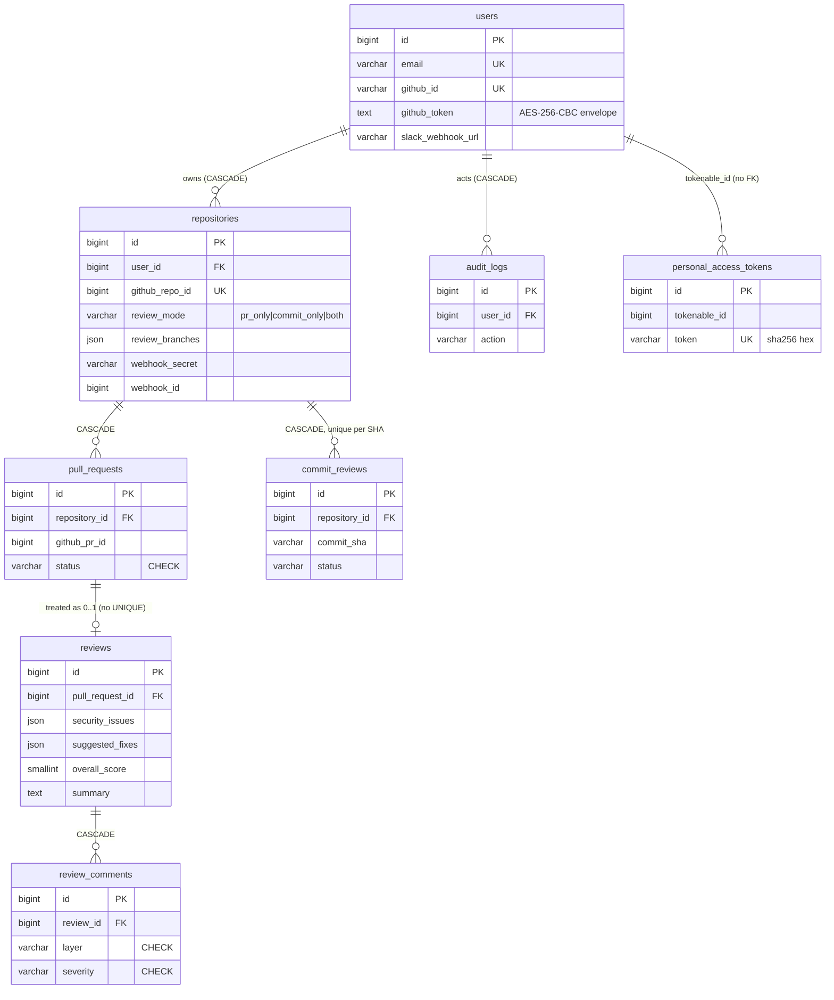

# Database and stored data

Everything PRism stores, and the rules that keep it readable. For Postgres,
[`prism-api/schema.sql`](../prism-api/schema.sql) is the source of truth; this page explains
it and covers what SQL cannot: JSON shapes, Redis keys, encoded formats, deletion and known
integrity gaps.

## Where data lives

| Store | Holds | Durability |
|---|---|---|
| **PostgreSQL 16** (Neon in production) | Users, repositories, pull requests, reviews, commit reviews, review comments, API tokens, audit log | Durable. Production data predates this codebase |
| **Redis** (Upstash, `noeviction`) | The review queue, Design Studio blueprints, saved risk assessments, session revocations, erasure markers, diff and GitHub-response caches, the design rate limit | Everything except the queue has a TTL, from seconds up to 90 days |
| **Process memory** (`prism-api`) | Request rate-limit counters | Lost on restart or deploy |
| **Browser `localStorage`** | `prism-theme`, and `prism:design-checklist:{designId}` (ticked readiness items) | Per browser; never sent to the server |

PRism never clones or stores a repository. Full diffs live only in the Redis cache for one
hour. Postgres does keep short quoted snippets (`problematic_code` and `suggested_code` in
`suggested_fixes`) and, when parsing failed, up to 1,500 characters of raw model output in
`summary`.

## The rules that bind this schema

Production rows and deployed MCP clients depend on these. Breaking one usually produces wrong
data, not an error. The history is in [ADR 0001](adr/0001-keep-the-stored-formats.md).

1. **`synchronize: false` and `migrationsRun: false`, forever.** TypeORM never creates or
   alters a table. Reconciliation would drop CHECK constraints.
2. **DDL is applied by hand** from `schema.sql`. There is no migration tool, and who applies
   DDL to production and how it is rolled back is an open decision.
3. **Status columns are `varchar`, never Postgres enums.** Entities declare `varchar` with a
   TypeScript union. `type: 'enum'` would make TypeORM look for a type that does not exist.
4. **`bigint` ids serialise as JSON numbers.** node-postgres returns strings, and
   `database/transformers.ts` converts them back.
5. **Timestamps are stored in UTC and served as `YYYY-MM-DDTHH:MM:SS+00:00`** (below).
6. **`users.github_token` and API tokens keep their legacy encodings** (below).
7. **`/api/v1` response fields may be added, never removed.**

## Entity relationships



A pull-request review is two rows: `pull_requests` for the PR and `reviews` for its latest
analysis. A commit review is one row that holds identity, status and analysis together.
Commit reviews have no comment table.

## Tables

Every table has an `id bigint` from its own sequence. Timestamps are
`timestamp(0) without time zone`. Structured columns are `json`, not `jsonb`, and nothing
queries inside them. **`updated_at` is not automatic**: entities use plain `@Column`, so it
changes only where code sets it. For pull requests that matters, because `updated_at` is
part of the diff-cache key.

### `users`

| Column | Type | Notes |
|---|---|---|
| `name`, `email` | varchar(255) NOT NULL | `email` is UNIQUE. Login writes `''` when GitHub returns none ([T4](known-issues.md#t4)) |
| `email_verified_at`, `password`, `remember_token` | | Legacy. Never written (`password` is read only by `DELETE /profile`) |
| `github_id` | varchar(255) | UNIQUE |
| `github_token` | text | Encrypted envelope; rewritten on every login |
| `github_avatar`, `github_username` | varchar(255) | |
| `email_notifications` | boolean NOT NULL DEFAULT true | **Unmapped.** The email feature was removed; nothing reads or writes it. Dropping it is hand-applied DDL |
| `slack_webhook_url` | varchar(255) | Plaintext; must start with `https://hooks.slack.com/` |

### `repositories`

| Column | Type | Notes |
|---|---|---|
| `user_id` | bigint NOT NULL | FK -> `users` ON DELETE CASCADE |
| `name`, `full_name` | varchar(255) NOT NULL | `full_name` is `owner/repo` |
| `github_repo_id` | bigint NOT NULL | **UNIQUE across all users** |
| `webhook_id` | bigint | GitHub's hook id, set after the hook is created |
| `webhook_secret` | varchar(255) NOT NULL | Plaintext, 40 random alphanumerics; the HMAC key |
| `is_active` | boolean NOT NULL DEFAULT true | Always written `true`; nothing gates on it |
| `review_mode` | varchar(32) NOT NULL DEFAULT `'pr_only'` | `pr_only`, `commit_only` or `both`. **No CHECK**; the DTO guards it |
| `review_branches` | json | `string[]`, at most 200 entries of at most 255 characters. `null` or `[]` means `main` and `master`, not "all branches" |

Index `repositories_user_active_idx (user_id, is_active)`.

### `pull_requests`

| Column | Type | Notes |
|---|---|---|
| `repository_id` | bigint NOT NULL | FK CASCADE |
| `github_pr_id` | bigint NOT NULL | GitHub's global PR id. **No UNIQUE** ([G2](known-issues.md#integrity-gaps)) |
| `pr_number` | integer NOT NULL | |
| `title`, `author`, `base_branch`, `head_branch` | varchar(255) NOT NULL | From the webhook; not truncated |
| `status` | varchar(255) NOT NULL DEFAULT `'pending'` | **CHECK** in `pending`, `analyzing`, `completed`, `failed` |
| `diff_url` | varchar(255) | |
| `detected_languages` | json | `string[]` of display names such as `"TypeScript"` |

Indexes `(repository_id, created_at)` and `(repository_id, status)`.

### `reviews`

The latest analysis of one pull request.

| Column | Type | Notes |
|---|---|---|
| `pull_request_id` | bigint NOT NULL | FK CASCADE. Non-unique index only ([G1](known-issues.md#integrity-gaps)) |
| `security_issues`, `performance_issues`, `code_quality_issues` | json | `ReviewIssue[]` |
| `suggested_fixes` | json | `{ fixes: SuggestedFix[] }`. `null` until the second pass finishes |
| `overall_score` | smallint | 0 to 100 or null. **No CHECK**; enforced in code |
| `summary` | text | Its prefix is meaningful ([below](#summary-text)) |
| `ai_model_used` | varchar(255) | `groq/<model id>`: the model that answered, or the last one tried |

Index `reviews_pr_created_idx (pull_request_id, created_at)`.

### `commit_reviews`

| Column | Type | Notes |
|---|---|---|
| `repository_id` | bigint NOT NULL | FK CASCADE |
| `commit_sha` | varchar(64) NOT NULL | **UNIQUE (repository_id, commit_sha)** |
| `commit_message`, `author` | text, varchar(255) | |
| `branch` | varchar(255) NOT NULL | |
| `status` | varchar(16) NOT NULL DEFAULT `'pending'` | Same four values as pull requests, **but no CHECK** |
| `overall_score`, `summary`, `*_issues`, `suggested_fixes`, `detected_languages`, `ai_model_used` | | As in `reviews` |

Indexes `(repository_id, created_at)` and `(repository_id, status)`.

### `review_comments`

One row per finding on a PR review, written alongside the JSON arrays.

| Column | Type | Notes |
|---|---|---|
| `review_id` | bigint NOT NULL | FK CASCADE |
| `file_path` | varchar(255) NOT NULL | |
| `line_number` | integer | |
| `layer` | varchar(255) NOT NULL | **CHECK** in `security`, `performance`, `code_quality` |
| `severity` | varchar(255) NOT NULL | **CHECK** in `critical`, `warning`, `suggestion` |
| `comment` | text NOT NULL | |
| `github_comment_id` | bigint | Never written; there are no inline GitHub comments yet |

### `personal_access_tokens`

| Column | Type | Notes |
|---|---|---|
| `tokenable_type` | varchar(255) NOT NULL | Always `'App\Models\User'` (a legacy value that cannot change) |
| `tokenable_id` | bigint NOT NULL | `users.id`. **No FK** |
| `name` | varchar(255) NOT NULL | The user's label, at most 64 characters via the DTO |
| `token` | varchar(64) NOT NULL | **UNIQUE.** `sha256(plaintext)` as hex |
| `abilities` | text | Always `'["*"]'`; parsed but never enforced |
| `last_used_at`, `expires_at` | timestamp | `last_used_at` is updated without awaiting; `expires_at` is always null today but honoured if set |

### `audit_logs`

| Column | Type | Notes |
|---|---|---|
| `user_id` | bigint NOT NULL | FK CASCADE |
| `action` | varchar(64) NOT NULL | No CHECK; values below |
| `description` | text | A human-readable sentence |
| `metadata` | json | An object, or `null` (an empty object is stored as `null`) |
| `ip_address` | varchar(45) | Always `null` today |
| `created_at` | timestamp NOT NULL DEFAULT `CURRENT_TIMESTAMP` | |

| `action` | Written when |
|---|---|
| `login` | GitHub sign-in completes |
| `repo_connected` | A repository is connected |
| `settings_updated` | Slack settings or a repository's review settings change |
| `api_token_created`, `api_token_revoked` | Token lifecycle |
| `review_reanalyzed` | Re-analyze from the web or the API |
| `review_completed` | A runner finishes with a usable result |
| `data_exported` | A PDF is exported |
| `design_created` | A blueprint is saved |
| `account_deleted` | Written during deletion, then removed by the cascade ([G10](known-issues.md#integrity-gaps)) |

### Tables not in `schema.sql`

`sessions`, `password_reset_tokens`, `jobs`, `job_batches`, `failed_jobs`, `cache`,
`cache_locks` and `migrations` still exist in the production database from the original
application. Nothing reads them and no entity maps them. Dropping them is a separate,
hand-applied decision.

## Structured JSON columns

**`ReviewIssue`**, each element of the three `*_issues` arrays, written by
`validateIssues()` after a finding has been checked against the diff:

```ts
{
  file: string;               // from the anchor, not from the model
  line: number;               // new-side number if side = 'added', old-side if 'removed'
  side: 'added' | 'removed';
  category: 'auth_weakened' | 'contract_changed' | 'no_timeout'   // blocking
          | 'error_swallowed' | 'untested_change' | 'migration_no_rollback' | 'other';
  severity: 'critical' | 'warning' | 'suggestion';
  comment: string;
}
```

Rows written before validation existed (before 2026-09-14) may lack `side` and `category`,
so every field is optional in the entity type.

**`suggested_fixes`** is an object, not a bare array:

```ts
{ fixes: Array<{
    layer: 'security' | 'performance' | 'code_quality';
    file: string;
    line: number | null;     // null when there is no quoted code to locate
    original_issue: string;
    problematic_code: string;
    suggested_code: string;
    explanation: string;
}> }                         // at most 5
```

**Derived, never stored:** the verdict and the ordered `findings` list are computed on read
in `ai/verdict.ts`. `overall_score` is stored already reconciled with the verdict.

### Summary text

A normal summary is optional notes (the coverage sentence, then "N reported issues could not
be traced..."), a blank line, then the model's summary. When no model produced usable output
it is exactly one of two strings:

- `AI review couldn't be parsed cleanly. Click Re-analyze to retry.`, followed by
  `\n\n— Raw output —\n` and up to 1,500 characters of the raw text; or
- `AI review didn't return any usable content. Click Re-analyze to retry.`

**These two prefixes are a contract.** `isIncompleteReview()` recognises them to report
`not_reviewed`. Reword one without the other and a review that checked nothing renders as a
green "nothing found".

## Encoded formats

### `users.github_token`

AES-256-CBC with an HMAC, in the envelope format of the original application.
[`crypt.service.ts`](../prism-api/src/common/utils/crypt.service.ts) is the only reader and
writer.

1. The key is `APP_KEY` without its `base64:` prefix, base64-decoded to exactly 32 bytes. The
   service refuses to start otherwise.
2. The plaintext is PHP-serialised first: `s:<UTF-8 byte length>:"<token>";`.
3. Encrypt with a random 16-byte IV, PKCS#7 padding.
4. `value` is base64(ciphertext), `iv` is base64(IV), `mac` is the hex HMAC-SHA256 of
   `iv + value` (the two base64 strings concatenated) under the same key.
5. Stored as `base64(JSON.stringify({ iv, value, mac, tag: '' }))`, keys in that order.

Decryption verifies the MAC in constant time before decrypting. The PHP serialisation is part
of the stored bytes and cannot become JSON without rewriting every row. **Rotating
`APP_KEY` makes every stored token unreadable**; every review for that user then fails after
three retries until they sign in again.

### API tokens

Issued as `{id}|{plaintext}` with a 40-character alphanumeric plaintext, shown once. The row
stores `sha256(plaintext)` hex. With a `|`, the guard loads by id and compares hashes in
constant time; without one (a legacy shape) it looks up `sha256(whole token)`. Expired tokens
are refused. The format cannot drift: deployed MCP servers hold tokens in it.

### Other secrets

| Value | Stored as |
|---|---|
| `repositories.webhook_secret` | plaintext, 40 characters |
| `users.slack_webhook_url` | plaintext |
| Session JWT | not stored; only revoked ones, as `sha256(jwt)` in Redis |

## Timestamps

`main.ts` registers `database/pg-types.ts` before any DataSource connects and pins
`process.env.TZ = 'UTC'`, so `timestamp without time zone` (OID 1114) is parsed as UTC.
Columns are `timestamp(0)`: whole seconds. Every API timestamp goes through
`common/utils/iso8601.ts`, which emits `YYYY-MM-DDTHH:MM:SS+00:00`. Never use
`Date#toISOString()`: its `.000Z` form is a different string for the same instant, and the MCP
client displays strings verbatim. Today's exceptions: `/security/my-data` formats dates as
`Mon DD, YYYY`, and the two routes that return raw entities (`POST /repositories`,
`PATCH /profile`) emit `.000Z`.

## Redis keyspace

Two connections. The general client prefixes every key with `REDIS_PREFIX` (default
`prism:`), including keys inside Lua scripts. BullMQ uses its own connection and
`QUEUE_PREFIX` (default `prism-bull`). **The instance must run `maxmemory-policy
noeviction`.** Keys below are logical; the physical key is `prism:` plus the key.

| Key | Value | TTL | Written by | Purged on account deletion |
|---|---|---|---|---|
| `account:erased:{userId}` | `'1'` | 1 h | `AccountDataService`, first step of deletion | expires; it is the purge's guard |
| `design:{uuid}` | `{owner_id, blueprint}` | 30 d | `DesignStore` save script | yes |
| `design:user:{userId}` | ids, newest first, trimmed to 20 | 30 d, refreshed on save | save script | yes |
| `design:owned:{userId}` | set of all ids | 30 d, refreshed on save | save script | yes |
| `design:rate:{userId}:{hourBucket}` | counter | 1 h | `DesignStore.hit()`; limit 10 per clock hour | current bucket only |
| `review-risk:pr:{pullRequestId}` | risk assessment | 90 d | PR runner, through the save script | yes (by PR ids read from Postgres) |
| `session:revoked:{sha256(jwt)}` | `'1'` | until the JWT's own expiry | `POST /auth/logout` | not user-keyed |
| `nest-cache-commit_diff_{repoId}_{sha}` | raw diff (at most 2 MB) | 1 h | runners, risk service | **no** ([G9](known-issues.md#integrity-gaps)) |
| `nest-cache-pr_diff_{prId}_{sha1(head_branch\|updated_at)}` | raw diff | 1 h | runners, risk service | **no** |
| `nest-cache-user_repos_{userId}` | GitHub `/user/repos` response | 5 min | `RepositoriesService` | no |
| `nest-cache-user_connected_repos_{userId}` | `number[]` | 10 min | `RepositoriesService` | no |
| `nest-cache-repo_branches_{userId}_{sha1(full_name)}` | `[{name, is_default}]` | 10 min | `RepositoriesService` | no |

**The write-through-the-marker rule.** Any store that holds a user's data must write through
an atomic script that refuses while `account:erased:{userId}` exists, and must be purged by
`AccountDataService`. `DesignStore` and `ReviewRiskStore` do. Without that, a review or
design in flight during deletion re-creates data nothing can find. Every `MULTI/EXEC` result
is checked per command.

**Blueprint** (`design:{uuid}`): the owner id is stored *beside* the blueprint, never in it.
A missing, expired, malformed or foreign id all return the same 404.

**BullMQ**: queue `prism-reviews`; job names `commit-review` and `pr-review`; job data is only
`{ commitReviewId }` or `{ pullRequestId }`.

Entries written by the original application (PHP-serialised, under its own cache prefix)
share the instance and are deliberately ignored.

## Data lifecycle

```text
webhook -> pull_requests (pending) -> job -> analyzing
        -> reviews upserted, review_comments replaced, suggested_fixes filled
        -> completed                      (or failed after the third attempt)

webhook -> commit_reviews (pending, one per repo+SHA) -> job -> analyzing -> completed | failed
```

### Account deletion

`DELETE /security/my-data` with `{ "confirm": "DELETE" }` runs `AccountDataService.deleteAccount`:

1. Set `account:erased:{userId}` for one hour.
2. Read the user's PR ids from Postgres and delete their `review-risk:pr:*` keys.
3. Delete every `design:*` key the user owns.
4. Remove each repository's GitHub webhook, then delete the `users` row. The cascade removes
   repositories, pull requests, reviews, comments, commit reviews and audit logs.
5. On any failure, delete the marker and return 503 saying the account has not been deleted.

Left behind: `personal_access_tokens` rows (no FK; unusable because user ids are never reused)
and the short-lived caches marked "no" above.

## Changing the schema

1. Write the DDL against a local Postgres 16 ([development.md](development.md)). Never point
   a local command at the root `.env`.
2. Update `schema.sql` in the same commit, and the entity: `varchar` plus a union for statuses,
   `bigintTransformer` on bigint columns.
3. Only additive changes for anything `/api/v1` serves.
4. Production application is manual and needs an owner and a written rollback first. That
   process is not yet decided, and it blocks the integrity fixes in
   [known-issues.md](known-issues.md#integrity-gaps).
