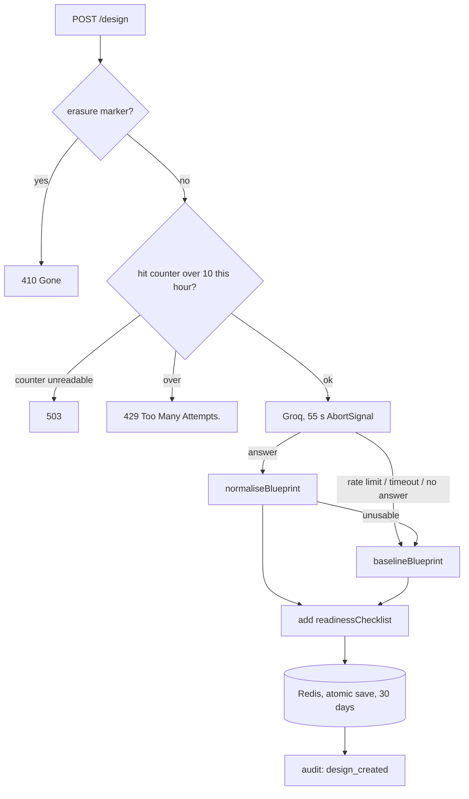

# Design Studio

The most expensive mistakes happen before any diff exists: no timeout budget, a queue with no
idempotency, a single database whose restore nobody has tried. A code reviewer arrives too late
for those. Design Studio produces a system design **before the first commit**, sized to the
load you actually expect, with the failure modes written down.

Code: [`prism-api/src/design/`](../prism-api/src/design) (pure) and
[`prism-api/src/modules/design/`](../prism-api/src/modules/design) (service, store, controllers).
Decisions: [ADR 0009](adr/0009-design-studio-inline-and-in-redis.md).

## Using it

| Where | How |
|---|---|
| **Web** | `/design` has the form and your history; `/design/[id]` shows the blueprint with *Copy Markdown* and *Download .md* |
| **API** | `POST /api/v1/designs`, `GET /api/v1/designs`, `GET /api/v1/designs/:id` ([reference](api-reference.md#create-a-design)) |
| **MCP** | `design_system` creates one and returns Markdown to commit (for example to `docs/design/<name>.md`); `get_design` fetches or lists |

A **brief** is: the product (20 to 4,000 characters), a scale, up to four ordered priorities and
optional constraints (up to 1,500 characters).

| Scale | Load the model is told to design for |
|---|---|
| `prototype` | under 1,000 users, about 1 request/second peak, one region |
| `startup` (default) | about 10,000 daily users, about 50 requests/second peak, one region |
| `growth` | about 1 million daily users, about 2,000 requests/second peak, multiple availability zones |
| `enterprise` | 10 million+ daily users, 20,000+ requests/second peak, multiple regions, contractual uptime |

Priorities: `high_availability`, `low_latency`, `strong_consistency`, `low_cost`,
`fast_delivery`, `security_compliance`, `offline_first`.

## What a blueprint contains

Components (with why each exists), data stores, the request flow, reliability patterns,
**failure modes** (failure, impact, mitigation, detection), a staged scaling plan with numeric
triggers, trade-offs (decision, chosen, alternative, why), SLOs, security, observability, risks,
first milestones, and a **production-readiness checklist**. The types are in
[`blueprint.ts`](../prism-api/src/design/blueprint.ts).

## How it is generated

Design choices, each deliberate:

- **The prompt argues against over-engineering.** Scale bands are sent as numbers, not words,
  because "startup scale" means ten users to one person and ten thousand requests a second to
  another. The model is told the simplest design that meets the load wins and that every
  component needs a reason tied to the brief. Failure modes are the section it must spend its
  words on. [`design-prompt.ts`](../prism-api/src/design/design-prompt.ts) is separate from the
  review prompt builder, so the frozen review fixtures are untouched.
- **Model output is untrusted.** `normaliseBlueprint()` coerces types, trims and caps every
  string and list (title 120 characters, summary 1,500, short fields 160, others 600, lists of
  8), drops entries missing their defining field, and rejects a "design" with no components and
  no failure modes.
- **It degrades to less, never to nothing.** A rate limit, the 55 second budget firing, no model
  answering, or unusable output all produce the deterministic `baselineBlueprint()` for the
  brief's scale. It is labelled `source: "baseline"` with a `notice` saying which of those
  happened. This is the same rule as the review pipeline's: a completed result with the raw
  material beats a failed job.
- **The readiness checklist is never generated.** `readinessChecklist()` is a pure function of
  scale and priorities, so it is the part of every blueprint that is the same every time and true
  every time.
- **It runs inline, not on the review queue.** The queue runs at concurrency 1 to fit in 512 MB,
  so a design waiting behind three reviews would wait minutes while a person watches a form.
  The cost is bounded instead: an `AbortSignal.timeout(55 s)` *cancels* the Groq fetch, and a
  per-user limit of 10 per hour is checked in Redis *before* the model is called.
- **The limit is in the service, not `@Throttle`.** It has to be per user on both the web routes
  and the API-token routes (the global guard keys token callers by IP), it has to survive
  restarts, and it has to **fail closed**: if the counter cannot be read the request is refused
  with 503 rather than allowed.

## Storage

Blueprints live in **Redis for 30 days**, not Postgres. A new table would be hand-applied DDL
against a production schema whose history this codebase does not own, and a blueprint is a
working document whose durable copy is the Markdown you commit to your repository. The UI says
so.

| Key | Holds |
|---|---|
| `design:{uuid}` | `{owner_id, blueprint}`; the owner is stored beside the blueprint, never inside it |
| `design:user:{userId}` | the 20 newest ids, for the history list |
| `design:owned:{userId}` | every id the user owns, for deletion |
| `design:rate:{userId}:{hourBucket}` | the hourly counter |

A missing, expired, malformed or foreign id all return one identical 404 (`Design not found.`).
The save is an atomic script that refuses while the owner's erasure marker exists, and account
deletion purges every key above ([database.md](database.md#redis-keyspace)). If blueprints ever
need to outlive 30 days, the stored shape is already the row.

## Extending it

- **New section in a blueprint:** add it to `blueprint.ts`, the normaliser (with caps), the
  baseline, the Markdown renderer and the web `BlueprintView`, and change the prompt. Old stored
  blueprints will lack it, so the renderers must tolerate a missing section.
- **New priority or scale:** extend the `DESIGN_*` constants; the DTO, MCP `zod` schema and
  checklist read from them (the MCP schema is a separate copy in `mcp-server/index.js`; update it).
- **A change to the prompt** has no frozen fixtures to break, so measure it: run briefs across all
  four scales and read the output for over-engineering and for failure modes that are only
  generic ("add monitoring"). No live model output has been read by a person yet; see
  [known-issues.md](known-issues.md#roadmap).
