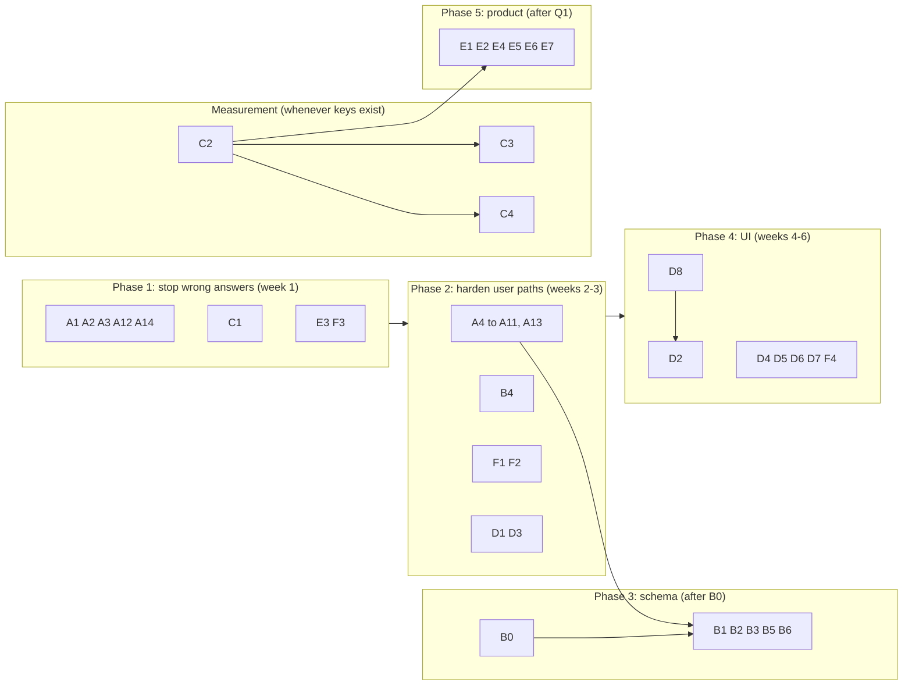

# PRism Plan

Status: written 2026-10-26 against `3ae7b5f`. This replaces `TODOS.md`, removed in the
same commit, whose four open items are carried forward below with their reasoning:
**TODOS 1 → B4, TODOS 2 → C1, TODOS 3 → C2, TODOS 4 → D2.**

Related: [PRD](PRD.md) · [App flow](Appflow.md) · [UI spec](Ui-spec.md) · [TRD](trd.md) · [Schema](schema.md)

---

## 1. Where things stand

PRism works end to end: OAuth sign-in, repository connection in three modes, webhook
reviews with anchor-validated findings, a verdict, Risk Radar, suggested fixes, GitHub
comments, Slack, a dashboard, PDF export, Design Studio, an MCP server with nine tools,
and full trust pages. CI gates typecheck, lint, tests (API 521, web 110), builds and a
dependency audit on every pull request. Local `main` matches `origin/main`.

What is not right yet, in order of how much it matters:

1. **One path still reports a review that checked nothing as clean** (T1). This breaks
   the product's central promise and is the first thing to fix.
2. **Nothing about review quality has been measured.** The success metrics in the PRD
   were pre-registered on 2026-09-14 and never run, because the measurement needs a Groq
   key and a GitHub token.
3. **Schema fixes are blocked on one decision**: who applies DDL to production, and how it
   is rolled back (PRD Q5). Five tasks wait on it.
4. **Reviews may be lost while the free-tier API sleeps** (T15), depending on where
   production webhooks point.
5. **A set of smaller correctness, privacy and UI defects** found in the 2026-10-26 audit,
   none yet reported by a user.
6. **The docs have drifted**: README, CLAUDE.md, MIGRATION.md and two design docs say
   things that are no longer true.

There are no outside users yet, so nothing here is an incident. It is the backlog to
clear before inviting any.

---

## 2. Rules for this plan

- **Measure before building.** Anything that changes the diff budget, the model list, the
  prompt or a threshold waits for C2.
- **No production DDL before B0.** Workstream A is written to need none.
- **One task, one pull request**, with tests. CI must be green.
- **Golden fixtures** change only on purpose, in the same commit as the prompt change,
  with the reason.
- **UI tasks** are checked in a real browser in both themes and at 390 px
  ([Ui-spec.md §12](Ui-spec.md#12-verification-checklist)).
- **Update these docs in the same pull request** when a task changes what they describe,
  and tick the task here.

Sizes: **S** under half a day, **M** one to two days, **L** three days or more.

---

## 3. Workstreams

### A. Correctness and safety (no schema change)

| ID | Task | Why | Done when | Size |
|---|---|---|---|---|
| A1 | **Never show an all-clear for a review that checked nothing.** (a) In both runners, require at least one of `security_issues`, `performance_issues`, `code_quality_issues`, `summary` with the right type; otherwise take the `incompleteReviewSummary` path. (b) Compute no verdict for a commit review that is not `completed`, and hide the panel until it is. | T1: `{}` or `{"error":…}` from JSON mode currently yields "NOTHING FOUND" on GitHub, and a pending, analyzing or failed commit review reads "Nothing found" (Ui-spec D31). | Specs: a parsed object with none of the keys produces `not_reviewed` with no comment, Slack or `review_completed`; an unfinished commit review has no verdict. | S |
| A2 | **Stop returning secrets.** `POST /repositories` returns a DTO without `webhookSecret`; `PATCH /profile` returns the same shape as `/auth/me`. Use `iso8601` timestamps there. | T2. | Specs assert the absent fields. | S |
| A3 | **Unthrottle `/health`:** `@SkipThrottle({ api: true })`. | T3: the route is meant to be unthrottled, but `@SkipThrottle()` skips a throttler named `default` and the only one is `api`, so each caller is still capped at 100/min. | Spec on the decorator metadata. | S |
| A4 | **Fix login email handling.** Never write `''` (use GitHub's `{id}+{login}@users.noreply.github.com` form or keep the existing value); stop overwriting a name or email the user edited; replace the raw exception text in `/login?error=` with a fixed message and log the detail. | T4, G5, UI D28. | Two GitHub users without public emails can both sign in; spec covers it. | M |
| A5 | **Finish account deletion.** Delete `personal_access_tokens` rows; purge the user's diff and GitHub-response caches (key them so they can be found, or write them through the marker); make `DELETE /profile` remove webhooks too or remove that dead path (see D7); record the deletion somewhere that survives the cascade (a log line). | T5, G6, G9, G10. | Spec: after deletion no key or row references the user id. | M |
| A6 | **Harden repository connect; add disconnect.** Verify `github_repo_id` and `full_name` against GitHub with the user's token; return 409 for an already-connected repo; roll back when webhook creation throws; add `DELETE /repositories/:id` that removes the webhook and rows, with a UI entry on the settings page. | T6, G13. | Specs for each branch; disconnect verified in the browser. | M |
| A7 | **Clear stale results and use transactions.** On the "no usable output" paths reset findings, fixes and comments; wrap the PR persist, web re-analyze and connect in transactions. | T7, G7, G8. | Spec: a `not_reviewed` review has no findings or fixes beside it. | M |
| A8 | **De-duplicate jobs.** Give each job a BullMQ `jobId` from the row id and revision (PR `updated_at` or commit SHA) so a double click or redelivery does not enqueue twice. | T8: two jobs post two comments. | Spec on the queue service; manual double-click check. | S |
| A9 | **Gate PR events on mode.** Ignore `pull_request` events for `commit_only` repositories in the webhook handler as well as in the subscription. | T9: a failed hook PATCH leaves PR reviews running. | Webhook spec. | S |
| A10 | **Dashboard timeline: newest 50**, shown oldest to newest. | T10. | Service spec. | S |
| A11 | **Small defects:** PDF crash on unknown severity; do not cache branch-list failures; 404 on revoking an unknown token; `DesignStore.find/list` degrade instead of 500; length guards for `varchar(255)` values from webhooks and DTOs; `id` tiebreak in `/api/v1/reviews`. | T16, G14, G15. | One spec each. | M |
| A12 | **Config safety.** Set `ignoreEnvFile: true` in production and an explicit `envFilePath` of `prism-api/.env` otherwise, so the root `.env` can never load; add `DB_SSLMODE=verify-full` support. | T11. | Boot from the repo root with no env reads nothing. | S |
| A13 | **Webhook hardening.** Answer 401 for both "not connected" and "bad signature"; compute the HMAC over the raw `Buffer`; raise the body limit for `/webhook/github` only (GitHub caps payloads at 25 MB). | T12. | Specs; one real delivery verified. | S |
| A14 | **Docs truth pass.** README (§4.1 below), `prism-web/README.md` (Inertia references, no tests, Node 22.12), `mcp-server/README.md` (`npx` before publish, "~10s"), CLAUDE.md ("prism-web has no test runner"; "status columns are varchar + CHECK" is not true of `commit_reviews`; "the MCP server matches on the 401/429 bodies", it relays them), MIGRATION.md (renamed files, unchecked "COMPLETE"), LOCAL-VERIFICATION.md (53 routes, new pages, how to seed a session), the 2026-10-04 spec status line, and every `TODOS.md` reference (`design.store.ts:12`, `risk-radar-and-design-studio.md:113,142`, `review-output-trust-and-brevity.md`, `docs/superpowers/plans/2026-10-04-repository-reviews-page.md:24`) pointed at this file. | Stale docs mislead the next change. | No file except `docs/plan.md` refers to `TODOS.md`. | M |

### B. Schema decision and data integrity

| ID | Task | Why | Done when | Size |
|---|---|---|---|---|
| B0 | **Decide who applies production DDL and how it is rolled back.** Write a short runbook: take a Neon branch or snapshot first, apply on the branch, verify, apply to main, keep the reverse script beside the forward one. | PRD Q5. Blocks B1-B3, B5, B6. | `docs/` holds the runbook and one dry run on a Neon branch. | S |
| B1 | **UNIQUE `reviews(pull_request_id)`** after checking production for duplicates; switch the runner to `INSERT … ON CONFLICT`. | G1. | Constraint live; runner spec. | M |
| B2 | **UNIQUE `pull_requests(repository_id, github_pr_id)`** with the same duplicate check; upsert with `ON CONFLICT`. | G2. | As B1. | M |
| B3 | **CHECKs** on `commit_reviews.status`, `repositories.review_mode`, `overall_score BETWEEN 0 AND 100`. | G3, G4. Makes the "varchar + CHECK" rule true. | Constraints live; `schema.sql` updated. | S |
| B4 | **Separate a daily Groq limit from a per-minute one** (was TODOS 1). Read `retry-after` on a 429. Per-minute: keep throwing so BullMQ retries. Long: finish the review as `not_reviewed` with a third fixed summary prefix ("Groq's daily limit was reached…") that `isIncompleteReview()` recognises. | An all-models-429 throws; with 3 attempts the retries are 60 s and 180 s, so a **daily** limit marks the review `failed` permanently after about 4 minutes plus job time (TODOS said 13; the 600 s step is never reached). That is a knowingly accepted regression from when the same case completed with an error blob. An in-job wait was rejected because the worker runs at concurrency 1 and would block every other review. | Spec for both header magnitudes. This option **needs no DDL** and can ship before B0; a separate `rate_limited` status would need B0 and a CHECK change. | M |
| B5 | **Persist risk and coverage on the review row** (`risk_score`, `risk_level`, `coverage` columns) so the dashboard can trend risk without refetching diffs. | Risk-radar doc follow-up 4; review-output doc step 8. | Columns live, written by both runners, served additively. | M |
| B6 | **Drop what nothing reads:** `users.email_notifications`, the eight legacy tables (`sessions`, `jobs`, `cache`…). Add an FK or cleanup for `personal_access_tokens`. | Schema hygiene. | Applied with B0's runbook. | S |

### C. Measurement (needs keys)

| ID | Task | Why | Done when | Size |
|---|---|---|---|---|
| C1 | **Check what GitHub returns for a merge commit's diff** (was TODOS 2): `GET /repos/{owner}/{repo}/commits/{sha}` with `Accept: application/vnd.github.v3.diff` on a real merge commit. | The webhook reviews a push's head commit, which is a merge commit after every PR merge. If GitHub returns an empty or combined (`@@@`) diff, every post-merge review shows "no issues we could verify". Raised by an outside reviewer and **not verified**; do not build around it either way until measured. An earlier attempt hit the unauthenticated limit of 60/hour. | Result recorded here; if empty or combined, a task to skip or handle merge commits. Needs only a GitHub token. | S |
| C2 | **Run the model-accuracy arm of the harness** (was TODOS 3) and score the PRD success metrics. | The only evidence that can overturn the anchor decision, set `DIFF_LIMIT` (8,000 today; 40,000 fixes 4 of 5 under-covered PRs in the dry run) and measure the real fabrication rate. The coverage and prompt-overhead halves already ran with `--dry-run`. | Results in `docs/designs/review-output-trust-and-brevity.md`; follow-up tasks for budget, the 4,000-char fixes cut and the prompt. | M |
| C3 | **Read live Design Studio output.** Run 20 briefs across all four scales; read for over-engineering and generic failure modes; tighten the prompt from evidence. | No real Groq design has been read by a person; only the fallback path ran end to end. | Notes in the risk-radar design doc; prompt changes with evidence. | M |
| C4 | **Watch one person who is not the author read one review** and say what to fix. | The last PRD success metric; the assignment from the 2026-09-13 office hours. | Observation written up; issues filed. | S |

C2 command (never point it at the root `.env`; pass the key inline for this one command):

```bash
cd prism-api
GROQ_API_KEY=gsk_... npx ts-node scripts/measure-anchoring.ts \
  --prs scripts/prs.txt --budgets 8000,40000 --schemes raw,lines,anchors --repeats 2
```

It makes 132 Groq calls (11 PRs × 2 budgets × 3 schemes × 2 repeats) and costs nothing
else.

### D. UI quality

IDs in brackets are deviations in [Ui-spec.md §11](Ui-spec.md#11-known-deviations).

| ID | Task | Done when | Size |
|---|---|---|---|
| D1 | **In-app copy truth pass:** remove the PHP sample, `.jsx` path, CSRF claim and "IP Whitelist" card from Security; correct the storage policy (the design checklist key); fix "70+ (green)"; make failed-review copy name the real causes [D20-D23]. | Copy matches the code. | S |
| D2 | **Replace the five-tab layout** on both review pages with one prioritised findings list (was TODOS 4). The verdict panel now answers the question at a glance, so the tabs became a "show all" view: two ways of reading the same data on one page. `SeverityFilters` then filters across layers, which is what a reader wants. The blocker recorded in TODOS ("`prism-web` has zero test files") is gone: Vitest exists, so write view tests first. [D24] | Both views tested; browser-verified. | L |
| D3 | **Rendering bugs:** make `hover:`/`active:` backgrounds work (a Tailwind colour or a layered utility), scope `@tailwindcss/forms` to `class` strategy, set divider colours [D1-D3]. | No dead hover classes; checkboxes themed in dark mode. | S |
| D4 | **Contrast and tokens:** add `--danger-solid`; theme the chart; replace raw `rgba()` tints with `color-mix` on tokens; move hard-coded hex into tokens [D4-D10]. | `grep` finds no hex or palette `rgba` in components except GitHub language colours. | M |
| D5 | **Touch targets** to 44 px for icon buttons and 36→44 px for primary touch actions [D11-D12]. | Measured at 390 px. | S |
| D6 | **Accessibility:** dialog semantics, focus trap and Escape for the modal, drawer and menu; `inert` closed drawer; tab and toggle roles; live regions; labels; one `<h1>` [D13-D19]. | Keyboard-only and screen-reader pass. | M |
| D7 | **Behaviour:** reset the connect modal per repository and show its errors; `.catch` on every action call; keep the return URL through sign-in; give "Reviews" a page or remove it; remove or fix Profile's password delete; consistent H1 scale; confirm before deleting a design [D24-D30]. | Each fixed with a test where testable. | M |
| D8 | **Test the untested views:** Dashboard, Review and Commit views, Settings, Design Studio, server actions. | Each view has at least its states covered. | L |

### E. Product (after PRD Q1 is answered)

| ID | Task | Notes | Size |
|---|---|---|---|
| E1 | **GitHub App installation** alongside OAuth (PRD F19): per-repo permissions, installation tokens, no breaking change for OAuth users. | The README calls it "in progress"; no code exists. Webhook secret and token handling change shape, so design it against [schema.md](schema.md) first. | L |
| E2 | **Inline PR comments** through the Reviews API, using the validated anchor locations. `review_comments.github_comment_id` already exists. | Only after C2 shows locations are reliable. | L |
| E3 | **Publish `prism-code-review-mcp` 1.1.1 to npm** (owner action), so the `npx -y prism-code-review-mcp` line in `mcp-server/README.md` works. | Until then the documented install command fails. | S |
| E4 | **PDF parity:** verdict, ordered findings, fixes and risk; commit-review export. | | M |
| E5 | **Merge gate:** a GitHub commit status or check run from the verdict (blocking → failure). | Replaces the README's "block merges below score 40" idea: the verdict, not the score, is the trustworthy signal. | M |
| E6 | **Design drift:** link a blueprint to a repository and check PRs against its SLOs and failure-mode mitigations. | Risk-radar doc follow-up 2. | L |
| E7 | **Calibrate risk weights from outcomes** (reverts, incident-linked PRs) once there is data. | Follow-up 3. | L |

### F. Free-tier reliability

| ID | Task | Why | Done when | Size |
|---|---|---|---|---|
| F1 | **Find out whether webhooks survive a sleeping API, then fix it.** First check the production `APP_URL` (the webhook target) and a connected repository's "Recent deliveries" on GitHub after a sleep. If deliveries fail, the cheapest fix is to redeliver failed ones on boot and on a timer, through GitHub's hook-deliveries API, using each repository's `webhook_id`. | T15. Through `prism-web` a sleeping API gets Render's 429 and never wakes; direct to the API, a 40-60 s cold start exceeds GitHub's 10 s timeout. GitHub does not redeliver automatically. Keeping the API awake 24/7 would use the whole 750-hour monthly allowance. | A push during sleep produces a review within minutes of the next wake; verified once on production. | M |
| F2 | **Rate limiter:** set `trust proxy` to the real hop count; move counters to Redis; key a global (not per-route) bucket as the docs describe. | T14. | Specs; behaviour documented in [trd.md §4.5](trd.md#45-rate-limiting). | M |
| F3 | **Pin Node on Render** (22, matching CI) through `NODE_VERSION` or `.node-version`. | Render resolves only the `engines` ranges (`>=20.11`, `>=22.12`), so the major version can change under the app; CI tests on 22. | Deploy log shows the pinned version. | S |
| F4 | **Make `/health` report worker liveness** (last job heartbeat), still without failing the status code on the queue alone. | `queue: running` only means the queue is reachable. | Health body has the new field (additive). | S |

---

## 4. Sequence



**Phase 1** is small, independent work (A14, a docs pass, is the largest) that removes
the worst user-visible error (A1) and two privacy leaks (A2, A12). C1 is one API call and settles a question that could
otherwise invalidate commit mode. **Phase 2** clears the defects users would hit first.
**Phase 3** waits on the B0 decision, which is the owner's call, not engineering work;
B1 should also follow A8, so no new duplicates appear while the constraint goes in. **Measurement** runs in parallel the moment a Groq key is available; nothing in
D2 or E2 should start before C2 says the locations hold up.

### 4.1 README truth pass (part of A14)

Claims in `README.md` that are no longer true:

| Line | Claim | Reality |
|---|---|---|
| 11 | "~30s to wake" | Measured 42 s; through `prism-web` it never wakes on its own (wake page) |
| 30, 264 | Catches "React key-prop" | Rule removed; the prompt now forbids lint-level findings |
| 42, 176 | Language-specific checks for Ruby and Java | Detected, but no rules |
| 47, 173 | Score as the headline | The verdict is the headline; anchors, validation and coverage are not mentioned |
| 163 | "Revoke anytime from GitHub settings, data deleted immediately" | No handler for GitHub-side revocation exists |
| 228, 261 | "exponential backoff", "`tries=3`", "`failed()` handler" | Fixed custom schedule (60 s, 180 s), BullMQ `failed` event |
| 260, 262, 269, 310 | "~80% fewer upstream calls", "sub-50ms dashboard", "<5 minutes", "90% blast radius" | Unmeasured |
| 282-302 | Dual auth "In Progress", "6-8 hours" | No code (E1) |
| 315 | Roadmap: repository settings page | Shipped |
| 320 | Roadmap: multi-AI fallback chain | Contradicts the Groq-only decision |
| 341 | Docker Compose | None exists |
| 358-359 | IP whitelist bypass, Symfony IpUtils | Allow-listing removed; no PHP |
| 365 | "See CONTRIBUTING.md" | Deleted in `bec6ce6` |
| — | Missing | Repository reviews page, wake page, demo, web test suite, Node 22.12 for `prism-web`, MCP not yet on npm |

---

## 5. Risks to the plan

| Risk | Mitigation |
|---|---|
| B0 never gets decided, so schema fixes never ship | Every A task and B4 need no DDL; the integrity gaps stay documented in [schema.md §9](schema.md#9-known-integrity-gaps) |
| C2 shows `llama-3.3-70b-versatile` cannot follow the rules | Then budget and prompt work stops and the anchor decision is revisited before E2 |
| Groq free-tier limits during C2 or C3 | Spread runs over days; the harness repeats are independent |
| A UI rewrite (D2) regresses a view with no tests | D8 first: test the current behaviour, then change it |
| A fix to one runner misses the other | Review both runners in every pipeline PR; they are near-parallel on purpose |

---

## 6. Definition of done (every task)

1. `npm run typecheck`, `npm run lint` and `npm test` pass in each package touched; CI
   green.
2. A test that fails without the change.
3. Invariants in [trd.md §16](trd.md#16-invariants) still hold.
4. UI: browser-checked in both themes at 390 px and desktop, no console errors.
5. The docs in `docs/` that describe the changed behaviour are updated, and the task is
   ticked below.

## 7. Tracker

| Phase | Tasks | Done |
|---|---|---|
| 1 | A1, A2, A3, A12, A14, C1, E3, F3 | 0 / 8 |
| 2 | A4-A11, A13, B4, D1, D3, F1, F2 | 0 / 14 |
| 3 | B0, B1, B2, B3, B5, B6 | 0 / 6 |
| Measurement | C2, C3, C4 | 0 / 3 |
| 4 | D2, D4, D5, D6, D7, D8, F4 | 0 / 7 |
| 5 | E1, E2, E4, E5, E6, E7 | 0 / 6 |
