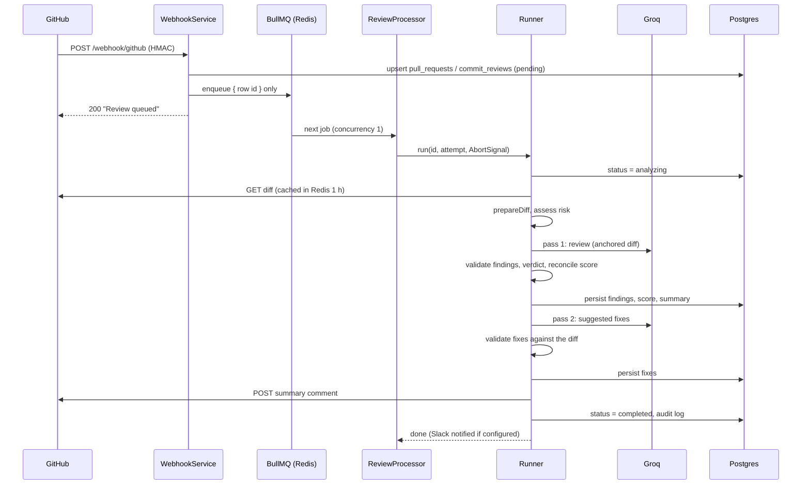
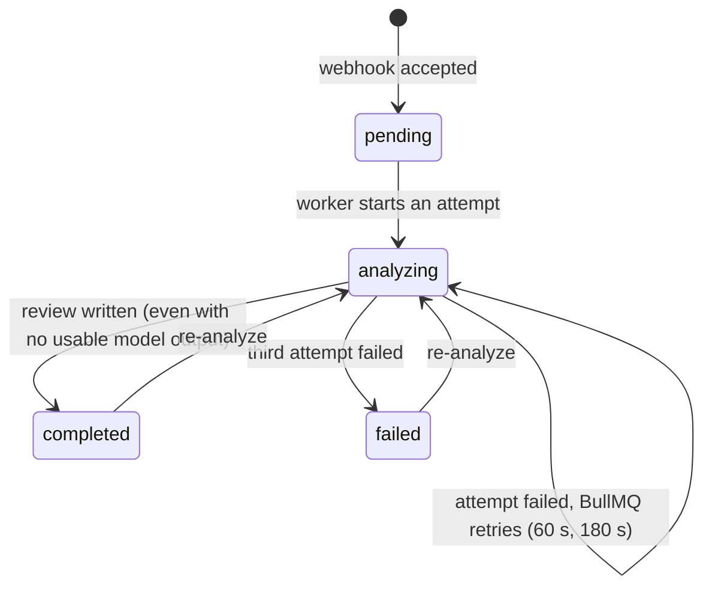

# The review pipeline

This is the life of one review, from a GitHub webhook to a comment on the pull request.
Read it before changing `modules/review/`, `ai/` or `diff/`. The reasoning behind the
non-obvious parts is in [ADR 0003](adr/0003-derive-the-job-budget-and-cancel-on-deadline.md),
[ADR 0006](adr/0006-validate-findings-against-the-diff.md) and
[ADR 0007](adr/0007-groq-is-the-only-ai-provider.md).

## Overview



**Own model first (optional, [ADR 0012](adr/0012-optional-user-supplied-api-key.md)).** When the
repository owner has saved their own provider key, pass 1 tries that model before the Groq chain, and
the fixes pass reuses it if it answered. Any failure (401/403/429/5xx, timeout, unparseable text)
falls through to the unchanged Groq chain. `ai_model_used` is `<provider>/<model>` for whatever
answered, for example `openai/gpt-4.1` or `groq/openai/gpt-oss-120b`. Design Studio does the same for
the signed-in user. Parse rates on other models are not measured.

A pull-request review and a commit review follow the same steps. They live in two files,
[`pr-review.runner.ts`](../prism-api/src/modules/review/pr-review.runner.ts) and
[`commit-review.runner.ts`](../prism-api/src/modules/review/commit-review.runner.ts), that are
near-parallel on purpose. **A change to one usually belongs in the other.**

## 1. Intake

[`WebhookService.handle`](../prism-api/src/modules/webhook/webhook.service.ts) runs these
checks in this order, and each outcome is visible in GitHub's "Recent deliveries" UI, so
the status codes and bodies are part of the contract:

| Step | Failure | Response |
|---|---|---|
| Parse the raw body as JSON | malformed | treated as `{}` |
| `repository.id` present | missing | 400 `Missing repository id` |
| Repository connected | unknown | 404 `Repository not connected` |
| `X-Hub-Signature-256` equals `sha256=` + HMAC-SHA256 of the raw body under the repository's `webhook_secret`, compared in constant time | mismatch | 401 `Invalid signature` |
| Event | `ping` | 200 `pong` |
| | anything else | 200 `Ignored event: <name>` |

There is no IP allow-list. Render's edge proxy masks GitHub's source address, so the HMAC
is the only authentication. This is also why `rawBody: true` is set in `main.ts`: the
digest is computed over the exact bytes GitHub sent.

**`pull_request`** events act only on `opened` and `synchronize`. The handler upserts the
`pull_requests` row with status `pending` and enqueues `pr-review {pullRequestId}`. Other
actions return `Ignored action: <name>`.

**`push`** events are filtered in this order, and the order is observable (a push to an
unwatched branch on a `pr_only` repository reports "PR-only mode", not "Branch not
watched"):

1. Repository mode is `pr_only` -> `Repository set to PR-only mode`.
2. The branch is not watched -> `Branch not watched: <branch>`. An empty or null
   `review_branches` means `main` and `master`, not "all branches".
3. `deleted: true` -> `Branch deleted, skipping`.
4. No head commit (`after` empty or forty zeros) -> `No head commit`.

Otherwise it creates a `commit_reviews` row for (repository, head SHA) if none exists,
and enqueues `commit-review {commitReviewId}`. A repeat push of the same SHA reuses the
row and keeps its original message and author.

The job payload is **only a row id**. Everything else is re-read from Postgres when the
job runs, so a job can never act on a stale copy of an entity.

## 2. The queue and the job budget

[`review.queue.ts`](../prism-api/src/modules/review/review.queue.ts) owns the policy:

| Setting | Value |
|---|---|
| Queue name | `prism-reviews` (a live Redis key; renaming it orphans queued jobs) |
| Job names | `pr-review`, `commit-review` |
| Attempts | 3 |
| Backoff | `[60, 180, 600]` seconds through a custom strategy. With 3 attempts only the first two delays happen |
| Retention | last 100 completed, last 500 failed |
| Worker concurrency | 1 |
| Per-attempt budget | `GROQ_TIMEOUT_MS x (models + 2) + GITHUB_TIMEOUT_MS x 2 + 30 s` = 60 x 4 + 30 x 2 + 30 = **330 s** (+2 = the fixes pass and one attempt on the user's own model) |

The budget is computed by importing the constants it covers. Adding a model or raising a
timeout raises it automatically.

[`ReviewProcessor`](../prism-api/src/modules/review/review.processor.ts) creates an
`AbortController` per attempt and aborts it when the budget is spent. The signal is passed
into every `fetch` (combined with that call's own timeout) and the runners call
`signal.throwIfAborted()` before persisting results and before posting the GitHub comment.
The deadline therefore **cancels** work. It does not merely stop waiting.

Runners let exceptions propagate so BullMQ retries. The processor's `failed` handler only
logs while attempts remain, and sets the row's status to `failed` after the last one.

## 3. Fetching the diff

[`GithubClientService`](../prism-api/src/github/github-client.service.ts) requests the PR or
commit with `Accept: application/vnd.github.v3.diff` using the repository owner's decrypted
token and a 30 s timeout. A non-2xx response throws, so the job retries.

The body is read as a stream and abandoned at **2,000,000 bytes**, because slicing a string
after reading it frees nothing. The result is cached in Redis for one hour:

- commit diffs by repository id and SHA (immutable per commit);
- PR diffs by PR id and a SHA-1 of `head_branch|updated_at`, so writing a fresh
  `updated_at` is the cache invalidation. Re-analyze routes depend on that.

A Redis failure on the cache falls through to GitHub and the job continues.

## 4. Preparing the diff

[`prepareDiff`](../prism-api/src/diff/prepare.ts) is shared by both runners and does four
things with a budget of `DIFF_LIMIT = 8000` characters:

1. **Select** (`file-selection.ts`). Skip noise (build output, vendored code, lockfiles,
   minified, binary and image files). Take whole files until the budget is spent. A file
   that does not fit is taken hunk by hunk; if not even one hunk fits, the first hunk is cut
   at a line boundary. A flat byte cut used to leave the model reasoning about half a hunk.
2. **Index** (`hunk-index.ts`). Parse the selected text into added lines (new-side
   numbers), removed lines (old-side numbers) and context, per file.
3. **Anchor** (`render.ts`). Prefix every changed line with an opaque id like `[7]`,
   numbered across the whole review, and keep a map from id to file, side and line.
4. **Detect languages** from the *whole* diff, not the selected slice, so truncation cannot
   decide which language rules the prompt carries.

It also produces a coverage sentence ("Reviewed 7 of 14 changed files. 1 of them only in
part.") that is stored in the summary whenever anything was left out.

### Coverage

`coverageRatio()` is the share of reviewable files the model was shown: a file included only in
part counts as half, and noise (lockfiles, generated, vendored, binary) is not in the
denominator. Below `MIN_COVERAGE` (0.5) the runners store `overall_score = null` and
`composeSummary` leads the summary with the fixed `PARTIAL_REVIEW` sentence, which
`isPartialReview()` recognises. On read, `verdictForReview` turns that into `partial` unless a
blocking finding exists. See [ADR 0011](adr/0011-partial-review-on-thin-coverage.md).

## 5. The first AI pass

[`PromptBuilderService.buildSystemPrompt`](../prism-api/src/ai/prompt-builder.service.ts)
builds a fixed system prompt that asks for `security_issues`, `performance_issues`,
`code_quality_issues` (each `{file, line, category, severity, comment}`), an integer
`overall_score` from 0 to 100, and a `summary`. It tells the model which things to look for,
in order, and explicitly not to report what a linter catches.

| Category | Blocks a merge? |
|---|---|
| `auth_weakened` | yes |
| `contract_changed` | yes |
| `no_timeout` | yes |
| `error_swallowed`, `untested_change`, `migration_no_rollback`, `other` | no |

Language rules are appended for PHP, JavaScript and TypeScript, Python and Go. Ruby and Java
are detected and named in the prompt but have no rules.

The anchor instructions ("put the anchor id in the `line` field") travel in the **user**
message, not the system prompt, because the system prompts are frozen byte for byte by test
fixtures ([testing.md](testing.md)). The model still returns an integer in `line`, so the
frozen schema is untouched.

[`AiClientService.callWithFallback`](../prism-api/src/ai/ai-client.service.ts) then:

- tries `openai/gpt-oss-120b`, then `openai/gpt-oss-20b`, at temperature 0.2 with
  `response_format: {type: 'json_object'}`, `max_completion_tokens: 8192` and
  `include_reasoning: false`, 60 s per call ([ADR 0007](adr/0007-groq-is-the-only-ai-provider.md));
- prepends a stronger "raw JSON only" instruction to the system prompt;
- returns the first model whose answer parses (`extractJson`: raw parse, fenced block,
  trailing-comma repair, first `{...}`);
- treats a network error or per-call timeout as "try the next model";
- **throws `RateLimitedError`** when every model answered 429, so BullMQ retries with its
  60 s and 180 s backoff;
- otherwise returns `parsed: null` with the last raw text.

Every call logs an `ai_call` line with the model, status, duration and token counts.

When `parsed` is `null` the runner stores a completed review with a null score, empty
findings, no comment, and one of two fixed summaries
(`AI review couldn't be parsed cleanly...` with up to 1,500 characters of raw output, or
`AI review didn't return any usable content...`). The verdict reads those prefixes and
reports `not_reviewed`. See [ADR 0007](adr/0007-groq-is-the-only-ai-provider.md).

## 6. Validation, verdict and score

[`validateLayers`](../prism-api/src/ai/issue-validator.ts) checks every finding against the
anchor map. A finding survives only if its `line` resolves to an anchor and, where the model
also named a file, that file matches the anchor's. The stored `file`, `line` and `side`
come from the **anchor**, never from the model. Drops are counted by reason (`malformed`,
`noAnchor`, `unknownAnchor`, `fileMismatch`) and logged as `issue_validation`. An unknown
category becomes `other` and an unknown severity becomes `suggestion`.

[`verdictFor`](../prism-api/src/ai/verdict.ts) is then computed from the survivors:

| Verdict | Rule |
|---|---|
| `nothing_found` | no findings |
| `blocking` | any finding has a blocking category |
| `worth_a_look` | otherwise |
| `not_reviewed` | not computed here; applied on read when the summary starts with a fallback prefix |
| `partial` | not computed here; applied on read when the summary starts with `PARTIAL_REVIEW` and no finding is blocking |

`reconcileScore` pulls the model's score into agreement with the verdict: at most 60 when
blocking, at least 80 when nothing was found, and a null score stays null. Without that, a
review that reported six problems, lost five to validation and kept a score of 88 would
print "88/100" above the word BLOCKING.

The verdict is **never stored**. It is derived on every read from the findings and the
summary. The stored `overall_score` stays in every API response because the contract is
additive-only ([ADR 0010](adr/0010-lead-with-a-verdict-and-keep-the-score.md)).

## 7. Persistence

Pull-request reviews write the `reviews` row (find-then-insert), save the Risk Radar
assessment of the diff that was reviewed (`ReviewRiskStore`, Redis, 90 days), and replace
`review_comments` wholesale so a re-analyze cannot accumulate them. Commit reviews write
the same fields onto the single `commit_reviews` row.

## 8. The second AI pass: suggested fixes

[`FixesService`](../prism-api/src/ai/fixes.service.ts) is skipped (storing `{fixes: []}`)
when no finding survived. Otherwise it sends the surviving findings plus the first 4,000
characters of the selected diff to **the model that succeeded in pass 1**, with no fallback.
At most five fixes are kept.

[`validateFixes`](../prism-api/src/ai/fix-validator.ts) keeps a fix only if its file is in
the diff and the first meaningful line of its `problematic_code` (whitespace-collapsed)
matches a changed line within 3 lines of the claimed line, or anywhere in the file when no
line was claimed. The line is snapped to the match. A fix with no quoted code is kept with
`line: null`. If this pass fails, `suggested_fixes` stays `null` and the review is kept.

## 9. Output

**GitHub comment** ([`summary-comment.builder.ts`](../prism-api/src/modules/review/summary-comment.builder.ts)).
Posted to the PR's issue timeline, or to the commit:

```text
## 🔍 PRism AI Review                      (or "... (Commit)")

**BLOCKING** - N findings - Score S/100
**1. `file:line`** - category
<comment>                                  (top 3 findings; the rest in a <details> block)
**Summary:** ...
**Change risk: HIGH** (score/100) - label - label - label
<details><summary>Before merging (n)</summary> - [ ] question `files` ... </details>
[View full review](APP_URL/reviews/{id})  - _Model: groq/..._
```

The risk section is appended only when an assessment is supplied. The comment POST does not
check the response status, so a repository where the token lost write access still completes
its review; a non-2xx or a network error is logged.

**Slack** ([`slack.service.ts`](../prism-api/src/notifications/slack.service.ts)): a legacy
attachment payload with a 10 s timeout, coloured green above 70, amber above 40, red
otherwise. Failures are caught and logged, never rethrown.

**Audit**: a `review_completed` row with the score.

**Status**: `pull_requests.status` or `commit_reviews.status` becomes `completed` after the
comment is posted, and `failed` only after the last retry.

## Status lifecycle



## Re-analyze

All four routes set the status to `analyzing` and enqueue a job. They differ on purpose:

| Route | Clears results? | Invalidates the diff cache by |
|---|---|---|
| Web `POST /commits/:id/re-analyze` | yes: findings, score, summary, fixes | deleting the SHA-keyed entry |
| `POST /api/v1/commits/:id/re-analyze` | yes, same | deleting the SHA-keyed entry |
| Web `POST /reviews/:id/re-analyze` | deletes the `reviews` row and its comments, forgets saved risk | writing a new `updated_at` |
| `POST /api/v1/pull-requests/:id/re-analyze` | **no**: the old review stays visible until the new one lands | writing a new `updated_at` |

The `updated_at` write is what makes the re-analyze work. The PR diff cache key includes it, so a re-analyze
that forgets it re-reviews the diff cached before the user pushed their fix, for up to an
hour, with no error anywhere. Entities use plain `@Column` timestamps, so nothing touches
`updated_at` automatically.

## How to change the pipeline safely

| You want to... | Do this |
|---|---|
| Change the system prompt | Edit `prompt-builder.service.ts`, regenerate the fixtures, and say why in the commit. Procedure in [testing.md](testing.md#changing-a-prompt-on-purpose) |
| Add or reorder a model | Re-measure parse rates first. Update `GROQ_MODELS`; the job budget follows |
| Add an issue category | Add it to `ISSUE_CATEGORIES`; decide whether it is blocking; update the prompt and fixtures; check the UI category labels |
| Add a language rule | Edit `getLanguageRules`; regenerate fixtures |
| Change what a runner does | Make the same change in the other runner, or write down why not |
| Add a side effect to a runner | Put a `signal.throwIfAborted()` before it, and make it safe to repeat |
| Change a fallback summary string | Change `UNPARSEABLE_REVIEW` / `EMPTY_REVIEW` in `ai/verdict.ts` only; they are shared on purpose |
