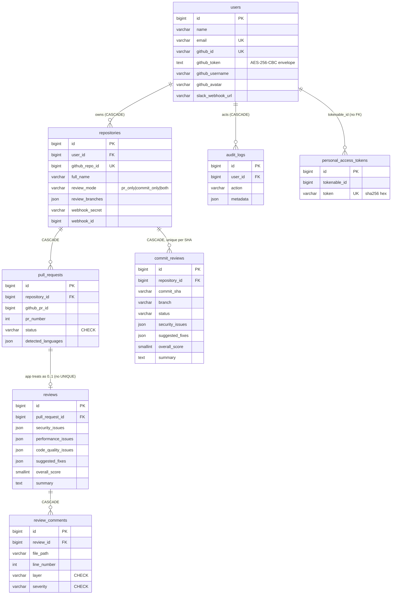

# PRism Data Schema

Status: describes the data PRism stores as of `3ae7b5f` (2026-10-26).
Source of truth for Postgres is [`prism-api/schema.sql`](../prism-api/schema.sql); this
document explains it and covers everything `schema.sql` cannot: JSON shapes, Redis keys,
encoded formats, deletion, and known integrity gaps.

Related: [PRD](PRD.md) · [App flow](Appflow.md) · [UI spec](Ui-spec.md) · [TRD](trd.md) · [Plan](plan.md)

---

## 1. Where data lives

| Store | Holds | Durability |
|---|---|---|
| **PostgreSQL 16** (Neon in production) | Users, repositories, pull requests, reviews, commit reviews, review comments, API tokens, audit log | Durable. Production data predates this codebase. |
| **Redis** (Upstash in production, `noeviction`) | Review queue (BullMQ), Design Studio blueprints, saved risk assessments, session revocations, erasure markers, diff and GitHub response caches, the Design Studio rate limit | Mixed: everything except the queue has a TTL, from seconds (a revocation lasts as long as its token had left) to 90 days. |
| **Process memory** (`prism-api`) | Request rate-limit counters (`@nestjs/throttler` default storage) | Lost on restart or deploy. |
| **Browser `localStorage`** | `prism-theme` (`'light'`, `'dark'` or absent), `prism:design-checklist:{designId}` (ticked readiness items) | Per browser. Never sent to the server. |

Repositories are never cloned or stored, and full diffs live only in the Redis cache
(1 hour). Postgres does keep short quoted snippets: `problematic_code` and
`suggested_code` in `suggested_fixes`, and up to 1,500 characters of raw model output in
`summary` when parsing fails. Saved risk assessments hold statistics and file paths, no
code.

### The rules that bind this schema

These hold because production rows and deployed MCP clients already depend on them.
Breaking one usually produces wrong data, not an error.

1. **`synchronize: false`, `migrationsRun: false`, forever.** TypeORM never creates or
   alters a table. Reconciliation would drop the CHECK constraints the status columns
   rely on.
2. **DDL is applied by hand** from `schema.sql`. There is no migration tool. Who applies
   DDL to production, and how it is rolled back, is an open decision (see
   [plan.md](plan.md), workstream B).
3. **Status columns are `varchar`, never Postgres enums.** Entities declare `varchar` with
   a TypeScript union. `type: 'enum'` would make TypeORM look for a type that does not
   exist.
4. **`bigint` ids serialise as JSON numbers.** node-postgres returns strings;
   `database/transformers.ts` (`bigintTransformer`) converts them back.
5. **Timestamps are written UTC and served as `YYYY-MM-DDTHH:MM:SS+00:00`** (§6).
6. **`users.github_token` and API tokens keep their legacy encodings** (§5).
7. **`/api/v1` response fields may be added, never removed.**

---

## 2. Entity-relationship diagram



A PR review lives in two rows (`pull_requests` for the PR, `reviews` for its latest
analysis). A commit review is one row (`commit_reviews`) that holds both. Commit reviews
have no comment table.

---

## 3. Tables

Conventions for every table: `id bigint` from its own sequence; timestamps are
`timestamp(0) without time zone` (fractional seconds rounded away); structured columns
are `json`, not `jsonb`, and nothing queries inside them. `updated_at` is **not**
automatic: entities use plain `@Column`, so it changes only where code sets it.

### 3.1 `users`

| Column | Type | Null | Default | Notes |
|---|---|---|---|---|
| `id` | bigint | no | seq | |
| `name` | varchar(255) | no | | From GitHub; editable on `/profile` |
| `email` | varchar(255) | no | | **UNIQUE.** Login writes `githubUser.email ?? ''` (see G5) |
| `email_verified_at` | timestamp | yes | | Only ever set to `null` |
| `password` | varchar(255) | yes | | Legacy. Never written; read only by profile delete |
| `remember_token` | varchar(100) | yes | | Legacy. Never written |
| `github_id` | varchar(255) | yes | | **UNIQUE** (NULLs distinct) |
| `github_token` | text | yes | | Encrypted envelope (§5.1). Rewritten on every login |
| `github_avatar` | varchar(255) | yes | | |
| `github_username` | varchar(255) | yes | | |
| `email_notifications` | boolean | no | `true` | **Unmapped.** Email was removed; nothing reads or writes it. Dropping it is hand-applied DDL. |
| `slack_webhook_url` | varchar(255) | yes | | Plaintext; must start with `https://hooks.slack.com/` |
| `created_at`, `updated_at` | timestamp | yes | | |

### 3.2 `repositories`

| Column | Type | Null | Default | Notes |
|---|---|---|---|---|
| `id` | bigint | no | seq | |
| `user_id` | bigint | no | | FK → `users.id` ON DELETE CASCADE |
| `name`, `full_name` | varchar(255) | no | | `full_name` is `owner/repo` |
| `github_repo_id` | bigint | no | | **UNIQUE across all users** |
| `webhook_id` | bigint | yes | | GitHub hook id, set after the hook is created |
| `webhook_secret` | varchar(255) | no | | Plaintext 40-char `[A-Za-z0-9]` secret for HMAC |
| `is_active` | boolean | no | `true` | Always written `true`; nothing gates on it |
| `review_mode` | varchar(32) | no | `'pr_only'` | `pr_only` \| `commit_only` \| `both`. **No CHECK**; guarded by the DTO |
| `review_branches` | json | yes | | `string[]` (≤ 200 entries, ≤ 255 chars each). `null` or `[]` means `['main','master']`, not "all branches" |
| `created_at`, `updated_at` | timestamp | yes | | |

Indexes: `repositories_user_active_idx (user_id, is_active)`.

### 3.3 `pull_requests`

| Column | Type | Null | Default | Notes |
|---|---|---|---|---|
| `id` | bigint | no | seq | |
| `repository_id` | bigint | no | | FK → `repositories.id` CASCADE |
| `github_pr_id` | bigint | no | | GitHub's global PR id. **No UNIQUE** (see G2) |
| `pr_number` | integer | no | | |
| `title`, `author`, `base_branch`, `head_branch` | varchar(255) | no | | From the webhook, not truncated |
| `status` | varchar(255) | no | `'pending'` | **CHECK** ∈ `pending`, `analyzing`, `completed`, `failed` |
| `diff_url` | varchar(255) | yes | | |
| `detected_languages` | json | yes | | `string[]` of display names, e.g. `"TypeScript"` |
| `created_at`, `updated_at` | timestamp | yes | | `updated_at` is part of the PR diff-cache key |

Indexes: `pull_requests_repo_created_idx (repository_id, created_at)`,
`pull_requests_repo_status_idx (repository_id, status)`.

### 3.4 `reviews`

The latest analysis of one pull request.

| Column | Type | Null | Notes |
|---|---|---|---|
| `id` | bigint | no | |
| `pull_request_id` | bigint | no | FK → `pull_requests.id` CASCADE. Non-unique index only (see G1) |
| `security_issues`, `performance_issues`, `code_quality_issues` | json | yes | `ReviewIssue[]` (§4.1) |
| `suggested_fixes` | json | yes | `{ fixes: SuggestedFix[] }` (§4.2) |
| `overall_score` | smallint | yes | 0-100 or null. **No CHECK**; range enforced in code (`clampScore`, `reconcileScore`) |
| `summary` | text | yes | See §4.4. Its prefix is meaningful |
| `ai_model_used` | varchar(255) | yes | `groq/<model id>`: the model that answered, or the last one tried when none produced usable output. The runners' `'multi-fallback'` default is unreachable. |
| `created_at`, `updated_at` | timestamp | yes | |

Index: `reviews_pr_created_idx (pull_request_id, created_at)`.

### 3.5 `commit_reviews`

One row per reviewed commit: the commit's identity, status and analysis together.

| Column | Type | Null | Default | Notes |
|---|---|---|---|---|
| `id` | bigint | no | seq | |
| `repository_id` | bigint | no | | FK → `repositories.id` CASCADE |
| `commit_sha` | varchar(64) | no | | **UNIQUE (repository_id, commit_sha)** |
| `commit_message` | text | yes | | |
| `author` | varchar(255) | yes | | |
| `branch` | varchar(255) | no | | |
| `status` | varchar(16) | no | `'pending'` | Same four values as `pull_requests.status`, **but no CHECK** (see G3) |
| `overall_score` | smallint | yes | | As `reviews` |
| `summary` | text | yes | | As `reviews` |
| `security_issues`, `performance_issues`, `code_quality_issues` | json | yes | | `ReviewIssue[]` |
| `suggested_fixes` | json | yes | | `{ fixes: SuggestedFix[] }` |
| `detected_languages` | json | yes | | `string[]` |
| `ai_model_used` | varchar(255) | yes | | |
| `created_at`, `updated_at` | timestamp | yes | | |

Indexes: `commit_reviews_repo_created_idx (repository_id, created_at)`,
`commit_reviews_repo_status_idx (repository_id, status)`.

### 3.6 `review_comments`

One row per finding on a PR review, written alongside the JSON arrays.

| Column | Type | Null | Notes |
|---|---|---|---|
| `id` | bigint | no | |
| `review_id` | bigint | no | FK → `reviews.id` CASCADE |
| `file_path` | varchar(255) | no | From diff paths, not truncated |
| `line_number` | integer | yes | |
| `layer` | varchar(255) | no | **CHECK** ∈ `security`, `performance`, `code_quality` |
| `severity` | varchar(255) | no | **CHECK** ∈ `critical`, `warning`, `suggestion` |
| `comment` | text | no | |
| `github_comment_id` | bigint | yes | Never written (no inline GitHub comments yet) |
| `created_at`, `updated_at` | timestamp | yes | |

Indexes: `(review_id, layer)`, `(review_id, severity)`.

### 3.7 `personal_access_tokens`

API tokens for `/api/v1` and the MCP server. The shape is inherited and fixed.

| Column | Type | Null | Notes |
|---|---|---|---|
| `id` | bigint | no | The `{id}` in `"{id}\|{plaintext}"` |
| `tokenable_type` | varchar(255) | no | Always `'App\Models\User'` |
| `tokenable_id` | bigint | no | `users.id`. **No FK** (polymorphic) |
| `name` | varchar(255) | no | User's label, ≤ 64 chars via the DTO |
| `token` | varchar(64) | no | **UNIQUE.** `sha256(plaintext)` as hex |
| `abilities` | text | yes | Always `'["*"]'`; parsed but never enforced |
| `last_used_at` | timestamp | yes | Updated fire-and-forget on each use |
| `expires_at` | timestamp | yes | Always `null` today; honoured if set |
| `created_at`, `updated_at` | timestamp | yes | |

Index: `(tokenable_type, tokenable_id)`.

### 3.8 `audit_logs`

| Column | Type | Null | Default | Notes |
|---|---|---|---|---|
| `id` | bigint | no | seq | |
| `user_id` | bigint | no | | FK → `users.id` CASCADE |
| `action` | varchar(64) | no | | No CHECK; values in §4.5 |
| `description` | text | yes | | Human-readable sentence |
| `metadata` | json | yes | | Object or `null` (an empty object is stored as `null`) |
| `ip_address` | varchar(45) | yes | | Always `null` today |
| `created_at` | timestamp | no | `CURRENT_TIMESTAMP` | App always passes it explicitly |

Index: `audit_logs_user_created_idx (user_id, created_at)`. No `updated_at`.

### 3.9 Tables left out of `schema.sql`

`sessions`, `password_reset_tokens`, `jobs`, `job_batches`, `failed_jobs`, `cache`,
`cache_locks` and `migrations` still exist in the production database from the original
application. Nothing reads them and no entity maps them. Dropping them is a separate,
hand-applied decision.

---

## 4. Structured values

### 4.1 `ReviewIssue` (each element of the three `*_issues` arrays)

Written by `validateIssues()` (`prism-api/src/ai/issue-validator.ts`) after every finding
has been checked against the diff. A finding whose anchor does not resolve to a changed
line is dropped, never stored.

```ts
{
  file: string;               // path from the hunk index, not from the model
  line: number;               // new-side number if side='added', old-side if 'removed'
  side: 'added' | 'removed';
  category: 'auth_weakened' | 'contract_changed' | 'no_timeout'      // blocking categories
          | 'error_swallowed' | 'untested_change' | 'migration_no_rollback'
          | 'other';          // unknown categories become 'other'
  severity: 'critical' | 'warning' | 'suggestion';  // invalid becomes 'suggestion'
  comment: string;            // trimmed, non-empty
}
```

Rows written before validation existed (before 2026-09-14) may lack `side` and
`category`; every field is optional in the entity type for that reason.

### 4.2 `suggested_fixes`

An object, not a bare array:

```ts
{
  fixes: Array<{
    layer: 'security' | 'performance' | 'code_quality'; // invalid becomes 'code_quality'
    file: string;
    line: number | null;        // null when there is no quoted code to locate
    original_issue: string;
    problematic_code: string;
    suggested_code: string;
    explanation: string;
  }>                            // at most 5
}
```

`FixesService` keeps at most five; `validateFixes()` drops any fix whose file is not in
the diff or whose quoted code is not found within ±3 lines of the claimed line. With no
issues, `{ fixes: [] }` is stored without calling the model. The column is `null` until
the second AI pass finishes, and stays `null` if that pass fails.

### 4.3 Derived, never stored: verdict and findings

The verdict shown on every page, in the GitHub comment and through the API is computed
on read (`prism-api/src/ai/verdict.ts`):

| Verdict | Rule |
|---|---|
| `not_reviewed` | `summary` starts with one of the two fallback strings in §4.4 |
| `nothing_found` | no findings |
| `blocking` | any finding has a category in `auth_weakened`, `contract_changed`, `no_timeout` |
| `worth_a_look` | otherwise |

`findings` is the three arrays merged and ordered worst first: blocking categories
first, then by severity, ties kept in stored order. `overall_score` is stored already
reconciled with the verdict: capped at 60 when blocking, raised to at least 80 when
nothing was found, left `null` when no model answered or the model gave no valid score.

### 4.4 `summary` text

- **Normal:** optional notes (a coverage sentence such as "Reviewed 7 of 14 changed
  files. 1 of them only in part.", then "N reported issues could not be traced…"), a
  blank line, then the model's summary. `null` when all are empty.
- **No usable model output:** exactly
  `"AI review couldn't be parsed cleanly. Click Re-analyze to retry."` followed by
  `"\n\n— Raw output —\n"` and up to 1,500 characters of raw text; or exactly
  `"AI review didn't return any usable content. Click Re-analyze to retry."`

**These two prefixes are a contract.** `isIncompleteReview()` recognises them to produce
`not_reviewed`. Rewording one without the other turns a review that checked nothing into
a green "nothing found".

### 4.5 `audit_logs.action` values

| `action` | `metadata` | Written when |
|---|---|---|
| `login` | null | GitHub sign-in completes |
| `repo_connected` | `{review_mode}` | A repository is connected |
| `settings_updated` | `{has_slack_webhook}` or `{review_mode, branches}` | Slack settings or a repository's review settings change |
| `api_token_created` | null | A token is generated |
| `api_token_revoked` | `{token_id}` | A token is revoked |
| `review_reanalyzed` | `{pull_request_id}` or `{commit_review_id}`, plus `source: 'api'` from `/api/v1` | Re-analyze from web or API |
| `review_completed` | `{pull_request_id \| commit_review_id, score}` | A runner finishes with a usable result |
| `data_exported` | `{pull_request_id}` | A PDF is exported |
| `design_created` | `{design_id, source: 'ai' \| 'baseline'}` | A blueprint is saved |
| `account_deleted` | null | Written during deletion, then removed by the cascade (see G10) |

The web page also has labels for `repo_disconnected`, which nothing writes (there is no
disconnect route).

### 4.6 Redis JSON values

**Blueprint** (`design:{uuid}` → `{ "owner_id": number, "blueprint": Blueprint }`, owner
stored beside the blueprint, never inside it). Fields, all snake_case
(`prism-api/src/design/blueprint.ts`):

```ts
Blueprint = {
  id: string /*uuid*/; created_at: string /*ISO +00:00*/;
  brief: { product: string; scale: 'prototype'|'startup'|'growth'|'enterprise';
           priorities: Array<'high_availability'|'low_latency'|'strong_consistency'|'low_cost'
                             |'fast_delivery'|'security_compliance'|'offline_first'>; // ≤ 4, ordered
           constraints: string };
  source: 'ai' | 'baseline'; model: string | null; notice: string | null;
  title: string; summary: string; architecture_style: string;
  components:     Array<{ name; responsibility; technology; why }>;
  data_stores:    Array<{ name; kind; holds; why }>;
  request_flow:   string[];
  reliability:    Array<{ pattern; where; why }>;
  failure_modes:  Array<{ failure; impact; mitigation; detection }>;
  scaling_stages: Array<{ stage; trigger; changes }>;
  tradeoffs:      Array<{ decision; chosen; alternative; why }>;
  slos:           Array<{ name; target }>;
  security: string[]; observability: string[]; risks: string[]; first_milestones: string[];
  readiness_checklist: Array<{ id; item; why }>;   // deterministic, never generated
}
```

**Risk assessment** (`review-risk:pr:{pullRequestId}`), from `diff/risk-radar.ts`:

```ts
{
  level: 'low' | 'medium' | 'high';   // low < 25 ≤ medium < 50 ≤ high
  score: number;                      // 0-100
  stats: { files, additions, deletions, sourceFiles, testFiles };  // camelCase
  signals: Array<{ id, label, weight, detail, files /* ≤ 5 */ }>;
  checklist: Array<{ id, question, why, files }>;                 // ≤ 6
}
```

---

## 5. Encoded formats

### 5.1 `users.github_token`

AES-256-CBC with an HMAC, in the envelope format of the original application.
`prism-api/src/common/utils/crypt.service.ts` is the only reader and writer.

1. Key: `APP_KEY` minus its `base64:` prefix, base64-decoded, exactly 32 bytes (the
   service refuses to start otherwise).
2. Plaintext is PHP-serialised first: `s:<UTF-8 byte length>:"<token>";`
3. Encrypt with a random 16-byte IV (PKCS#7 padding).
4. `value` = base64(ciphertext), `iv` = base64(IV), `mac` = hex HMAC-SHA256 of
   `iv + value` (the two base64 strings concatenated) under the same key.
5. Stored: `base64(JSON.stringify({ iv, value, mac, tag: '' }))`, keys in that order.

Decryption verifies the MAC in constant time before decrypting. The PHP serialisation
is part of the stored bytes and cannot be replaced with JSON without rewriting every row.
**Rotating `APP_KEY` makes every stored token unreadable**, and every review for that
user then fails after three retries until they sign in again.

### 5.2 API tokens

- Issued as `"{id}|{plaintext}"` where `plaintext` is 40 `[A-Za-z0-9]` characters, shown
  once. The row stores `sha256(plaintext)` hex in `token`.
- Verified by `auth/api-token-auth.guard.ts`: with a `|`, load by id and compare hashes
  in constant time; without one (legacy), look up `sha256(whole token)`. Expired tokens
  are refused. Every failure is 401 with body `{"message":"Unauthenticated."}`.
- **This format cannot drift.** Deployed MCP servers hold tokens in it.

### 5.3 Other secrets

| Value | Stored as | Used for |
|---|---|---|
| `repositories.webhook_secret` | plaintext, 40 chars | HMAC-SHA256 check of `X-Hub-Signature-256` |
| `users.slack_webhook_url` | plaintext | Slack incoming webhook |
| Session JWT | not stored; only revoked ones, as `sha256(jwt)` in Redis | Cookie `prism_session`, signed with `JWT_SECRET`, payload `{ sub, username }`, `SESSION_TTL_DAYS` (30) |

---

## 6. Timestamps

- `main.ts` registers `database/pg-types.ts` before any DataSource connects and pins
  `process.env.TZ = 'UTC'`. The parser reads `timestamp without time zone` (OID 1114) as
  UTC.
- Columns are `timestamp(0)`: whole seconds.
- Every API timestamp goes through `common/utils/iso8601.ts`:
  `YYYY-MM-DDTHH:MM:SS+00:00` (milliseconds truncated). **Not** `Date#toISOString()`,
  whose `.000Z` form the MCP client would display verbatim.
- Exceptions today: `/security/my-data` formats dates as `Mon DD, YYYY`, and the two
  routes that return raw entities (`POST /repositories`, `PATCH /profile`) emit `.000Z`
  (plan A2).

---

## 7. Redis keyspace

Two connections. The general client prefixes every key with `REDIS_PREFIX` (default
`prism:`), including keys inside Lua scripts and MULTI blocks; BullMQ uses its own
connection with `QUEUE_PREFIX` (default `prism-bull`). **The instance must run
`maxmemory-policy noeviction`**: under eviction BullMQ job keys disappear and reviews
silently never run.

Keys below are logical; the physical key is `prism:` + key.

| Key | Value | TTL | Written by | Purged on account deletion? |
|---|---|---|---|---|
| `account:erased:{userId}` | `'1'` | 1 h | `AccountDataService` at the start of deletion | Expires (it is the purge's guard) |
| `design:{uuid}` | `{owner_id, blueprint}` JSON | 30 d | `DesignStore` save script | **Yes** |
| `design:user:{userId}` | list of ids, newest first, trimmed to 20 | 30 d, refreshed on save | save script | **Yes** |
| `design:owned:{userId}` | set of all ids | 30 d, refreshed on save | save script | **Yes** |
| `design:rate:{userId}:{hourBucket}` | counter | 1 h | `DesignStore.hit()`; limit 10 per clock hour | Current bucket only |
| `review-risk:pr:{pullRequestId}` | risk assessment JSON | 90 d | PR runner, through the save script | **Yes** (by PR ids read from Postgres) |
| `session:revoked:{sha256(jwt)}` | `'1'` | until the JWT's own expiry | `POST /auth/logout` | Not user-keyed |
| `nest-cache-commit_diff_{repositoryId}_{sha}` | raw diff text (≤ 2 MB) | 1 h | runners, risk service | **No** (G9) |
| `nest-cache-pr_diff_{pullRequestId}_{sha1(head_branch + '\|' + updated_at)}` | raw diff text | 1 h | runners, risk service | **No** (G9) |
| `nest-cache-user_repos_{userId}` | GitHub `/user/repos` response | 5 min | `RepositoriesService` | **No** |
| `nest-cache-user_connected_repos_{userId}` | `number[]` of `github_repo_id` | 10 min | `RepositoriesService` | **No** |
| `nest-cache-repo_branches_{userId}_{sha1(full_name)}` | `[{name, is_default}]` | 10 min | `RepositoriesService` | **No** |

**Write-through-the-marker rule.** Any store that holds a user's data must write through
an atomic script that refuses while `account:erased:{userId}` exists, and must be purged
by `AccountDataService`. `DesignStore` (`SAVE_SCRIPT`) and `ReviewRiskStore`
(`SAVE_RISK_SCRIPT`) do. Without it, a review or design in flight during deletion
re-creates data nothing can find again. Every MULTI/EXEC result is checked per command.

**Design ids:** a missing, expired, malformed or foreign id all return the same 404.

**Legacy cache entries** written by the original application (PHP-serialised, under
`REDIS_PREFIX` + its cache prefix) share the instance and are deliberately ignored.

### 7.1 BullMQ

- Queue `prism-reviews`; physical keys `prism-bull:prism-reviews:*` (BullMQ internals).
- Job names `commit-review` and `pr-review`. **Job data is only a row id**:
  `{ commitReviewId }` or `{ pullRequestId }`. Everything else is re-read from Postgres
  when the job runs.
- Options: `attempts: 3`, custom backoff 60 s / 180 s / 600 s, keep the last 100
  completed and 500 failed jobs. Worker concurrency 1.

---

## 8. Data lifecycle

### 8.1 Review rows

```
webhook ─▶ pull_requests (status pending) ─▶ job ─▶ analyzing
        ─▶ reviews upserted, review_comments replaced, suggested_fixes filled
        ─▶ completed            (or failed after the third attempt)

webhook ─▶ commit_reviews (pending, one per repo+SHA) ─▶ job ─▶ analyzing ─▶ completed | failed
```

Re-analyze differs on purpose. A **commit** re-analyze clears the row's results and its
diff cache before re-queueing. A **web PR** re-analyze deletes the review and its
comments and forgets the saved risk; an **API PR** re-analyze keeps the old review
visible until the new one lands.

### 8.2 Account deletion

`DELETE /security/my-data` (body `{confirm: "DELETE"}`) runs
`AccountDataService.deleteAccount`:

1. Set `account:erased:{userId}` (1 h).
2. Read the user's PR ids from Postgres; delete their `review-risk:pr:*` keys.
3. Delete all `design:*` keys the user owns.
4. Remove each repository's GitHub webhook, then delete the `users` row. The cascade
   removes repositories, pull requests, reviews, review comments, commit reviews and
   audit logs.
5. On any failure: delete the marker and return 503 ("…it has not been deleted…").

Left behind: `personal_access_tokens` rows (no FK; unusable because user ids are never
reused), and the short-lived caches marked "No" in §7.

---

## 9. Known integrity gaps

Found in a code audit on 2026-10-26. None has caused a reported incident; each is a way
the data can go wrong. Fixes that need DDL wait on the DDL decision in [plan.md](plan.md).

| ID | Gap | Consequence |
|---|---|---|
| G1 | No UNIQUE on `reviews.pull_request_id`, and the runner's upsert is find-then-insert. | Two overlapping jobs for one PR (e.g. two instances during a deploy) can create two reviews; reads then pick one arbitrarily. |
| G2 | No UNIQUE on `pull_requests (repository_id, github_pr_id)`; the webhook upsert is find-then-insert. | Concurrent deliveries for one PR can create duplicate PR rows. |
| G3 | `commit_reviews.status` and `repositories.review_mode` have no CHECK (unlike `pull_requests.status`). | Only TypeScript guards the values. Contradicts the "varchar + CHECK" rule. |
| G4 | No CHECK on `overall_score`; the entity comment says there is one. | Range is enforced only in code. |
| G5 | `users.email` is NOT NULL UNIQUE, but login writes `''` when GitHub returns no email, and overwrites email on every login. | A second user without a public email cannot sign in; the raw constraint error is echoed into `/login?error=`. |
| G6 | `personal_access_tokens` has no FK and is not deleted with the account; the guard does not check `tokenable_type`; `abilities` is never enforced. | Orphaned rows; tokens are all-powerful within their user. |
| G7 | No transactions anywhere. Multi-step writes (PR persist, web PR re-analyze, repository connect) can stop half-way. | Partial results, e.g. comments deleted but the review kept. |
| G8 | The "no usable output" paths leave earlier fixes and comments in place (PR) or leave earlier issues in place (commit re-push of an existing SHA). | A `not_reviewed` summary can sit beside stale findings. |
| G9 | Account deletion does not purge diff caches (user code, ≤ 1 h) or GitHub response caches (≤ 10 min). | Breaks the erasure rule in §7 for up to an hour. |
| G10 | The `account_deleted` audit row is written just before the cascade removes it. | It never persists. |
| G11 | `updated_at` is skipped by most runner writes, `markFailed`, the API commit re-analyze and token use. | Misleading timestamps; for PRs it also feeds the diff-cache key. |
| G12 | A deletion that fails late has already removed some GitHub webhooks and Redis data. | The surviving account stops receiving events for those repositories. |
| G13 | No disconnect route; connect trusts client-supplied `github_repo_id` and names; a duplicate connect is an unhandled unique violation (500). | A wrong id can block the real owner; duplicates surface as server errors. |
| G14 | Webhook and diff values go into `varchar(255)` without truncation. | An over-long branch, title or path fails the insert. |
| G15 | `/api/v1/reviews` sorts merged lists by the `created_at` string with no tiebreak. | Rows in the same second order unpredictably. |

---

## 10. Changing the schema

1. Write the DDL against a local Postgres 16 started per `prism-api/LOCAL-VERIFICATION.md`.
   Never point a local command at the root `.env`; check the connection string says
   `127.0.0.1`.
2. Update `schema.sql` in the same commit, and the entity (varchar + union for statuses,
   `bigintTransformer` on bigint columns).
3. Additive changes only for anything `/api/v1` serves.
4. Production application is manual and needs an owner and a rollback written down
   first. That decision is still open and blocks G1-G4, the `coverage` column, persisted
   risk, and dropping `email_notifications` and the legacy tables.
