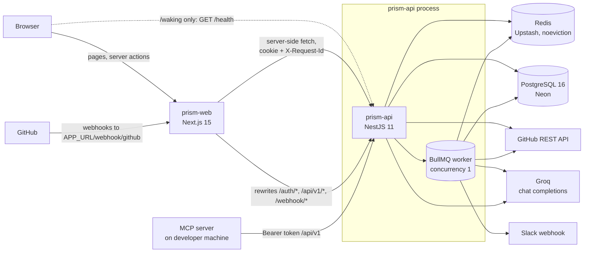

# PRism Technical Requirements Document

Status: describes the system as built at `3ae7b5f` (2026-10-26) and the technical rules
every change must keep. Product intent is in [PRD.md](PRD.md); stored data in
[schema.md](schema.md); open technical work in [plan.md](plan.md).

Related: [PRD](PRD.md) · [App flow](Appflow.md) · [UI spec](Ui-spec.md) · [Schema](schema.md) · [Plan](plan.md)

---

## 1. Scope

Three packages, no monorepo tooling, each with its own `package.json`:

| Package | What it is | Runtime |
|---|---|---|
| `prism-api/` | NestJS 11 REST API, GitHub webhook receiver, browser-facing routes, **and** the BullMQ review worker in the same process | Node ≥ 20.11 (CI uses 22) |
| `prism-web/` | Next.js 15 App Router frontend; all data fetched server-side | Node ≥ 22.12 |
| `mcp-server/` | Standalone MCP server (`index.js`, no build) that calls `/api/v1` with a bearer token | Node ≥ 18 |

The codebase is a TypeScript port of an earlier PHP application that has been deleted.
The production database, its schema and the API tokens in it predate this code, which is
the source of several fixed formats below.

---

## 2. Architecture



### 2.1 Process model

- **One API process does everything:** HTTP routes and the review worker. Render's free
  tier has no background-worker type, and `concurrency: 1` keeps peak memory inside
  512 MB. A design request runs inline on its HTTP request, not on the queue, so it never
  waits behind reviews.
- **The browser only talks to `prism-web`.** Every API call is made server-side from a
  React Server Component or a Server Action through `prism-web/src/lib/api.ts`, so the API
  origin, the session cookie and the user's GitHub token never reach client JavaScript.
  `PRISM_API_ORIGIN` therefore has no `NEXT_PUBLIC_` prefix.
- **One hostname.** The API sets the session cookie; a browser returns it only to the
  origin that set it, so both services must answer on one hostname. `next.config.mjs`
  rewrites `/auth/:path*`, `/api/v1/:path*` and `/webhook/:path*` to the API in every
  environment, and production relies on those rewrites until a reverse proxy exists
  (`render.yaml` says so). If this breaks, sign-in appears to work and every later
  request is anonymous.

### 2.2 The wake exception

On Render's free tier the API sleeps after 15 idle minutes. While it sleeps, Render's edge
answers requests from `prism-web` with 429 and `x-render-routing: hibernate-rate-limited`
without starting it; only a request from outside Render wakes it.

- `lib/api.ts` detects `x-render-routing` starting with `hibernate`. A page-load GET
  redirects to `/waking?next=<path>`; a write or server action throws
  `ApiError(503, 'The server was asleep. Reload this page to wake it, then try again.')`.
- `/waking` is the only page whose CSP `connect-src` includes the API origin. Its client
  pings `{apiOrigin}/health` (`no-cors`) every 10 s and polls same-origin `/auth/me`
  every 3 s, then `location.replace(next)`.
- Sign-in starts at `/login/github` (a route handler that probes `/health` first) rather
  than `/auth/github`, because the rewrite would proxy straight into the 429.

---

## 3. Technology stack

| Layer | Choice | Version (installed) |
|---|---|---|
| API framework | NestJS, Express 5 | 11.2.x |
| ORM | TypeORM + `typeorm-naming-strategies` (snake case), `pg` | 0.3.31, 8.23.0 |
| Queue | BullMQ via `@nestjs/bullmq`, ioredis | 5.81.4, 5.11.1 |
| Rate limiting | `@nestjs/throttler` (in-memory storage) | 6.5.0 |
| Auth | `@nestjs/jwt` (HS256), `cookie-parser`, `bcryptjs` (legacy profile delete only) | |
| Validation | `class-validator`, `class-transformer` | 0.14.4, 0.5.1 |
| Security headers | helmet | 8.3.0 |
| PDF | pdfmake (Roboto, URL and file access locked down) | 0.3.11 |
| AI | Groq OpenAI-compatible chat completions | `llama-3.3-70b-versatile`, `llama-3.1-8b-instant` |
| Frontend | Next.js App Router, React | 15.5.x, 19 |
| Styling | Tailwind CSS 3 + `@tailwindcss/forms`, CSS custom properties | 3.4.x |
| Icons, charts | lucide-react, Chart.js + react-chartjs-2 | 0.468, 4.5 |
| Fonts | `@fontsource-variable/inter` (opsz), `@fontsource-variable/jetbrains-mono` | self-hosted |
| Tests | Jest 29 + ts-jest (API); Vitest 5 + jsdom + Testing Library (web) | |
| MCP | `@modelcontextprotocol/sdk`, `zod` | ^1.23 (1.32.2), ^4.6.6 |
| Data | PostgreSQL 16 (Neon), Redis (Upstash) | |
| Hosting | Render free tier, region Singapore | |

`esModuleInterop` is off in `prism-api`: CommonJS packages use `import x = require('x')`.
TypeScript is strict with `noUncheckedIndexedAccess`.

---

## 4. Authentication and authorisation

### 4.1 GitHub OAuth

| Item | Value |
|---|---|
| Scopes | `repo read:user` |
| State | 32 random bytes hex in cookie `prism_oauth_state` (httpOnly, sameSite lax, `secure` in production, 10 min); compared in constant time; cleared at callback start |
| Code exchange | `POST https://github.com/login/oauth/access_token`, 15 s timeout |
| Profile | `GET https://api.github.com/user`, then `/user/emails` (primary verified, else any verified) when the email is private |
| Persist | Upsert by `github_id`; overwrite name and email; encrypt and store the token; audit `login` |
| Redirect | Success `{FRONTEND_URL‖APP_URL}/dashboard`; failure `…/login?error=GitHub sign-in failed: <message>` |
| Throttle | 10 requests/min on `/auth/github` and the callback |

`GITHUB_REDIRECT_URI` must point at `/auth/github/callback` on the shared hostname.

### 4.2 Browser session

- JWT signed with `JWT_SECRET` (≥ 32 chars, HS256), claims `{sub: userId, username}`,
  expiry `SESSION_TTL_DAYS` (30).
- Cookie `SESSION_COOKIE_NAME` (`prism_session`): httpOnly, sameSite lax, `secure` in
  production, path `/`, max-age = TTL.
- **`WebAuthGuard`** reads the cookie (or `Authorization: Bearer <jwt>`), verifies it,
  checks revocation, then **loads the user row** rather than trusting claims, so a deleted
  account stops working immediately. Any failure: 401 `Unauthenticated.`
- **`OptionalWebAuthGuard`** (only `GET /security`) never rejects; it attaches the user
  only for a valid, unrevoked token whose user exists.
- **Revocation:** `POST /auth/logout` stores `session:revoked:{sha256(jwt)}` in Redis
  until the JWT's own expiry and clears the cookie. The check **fails open** on a Redis
  error (an outage must not sign everyone out; the signature is still verified). Any new
  guard that reads the session must check revocation too.
- Rotating `JWT_SECRET` signs everyone out. It is not interchangeable with `APP_KEY`.

### 4.3 API tokens (`/api/v1`)

- Format `"{id}|{plaintext}"`, plaintext 40 `[A-Za-z0-9]`; the row stores
  `sha256(plaintext)` hex. A token without `|` is looked up by `sha256(whole)` (legacy).
- Verified in constant time; expired tokens refused; `last_used_at` updated
  fire-and-forget. Every failure: 401 `{"message":"Unauthenticated."}`.
- **The format cannot change**: deployed MCP servers hold tokens in it.

### 4.4 Authorisation

- Reviews and repositories are owned through `repositories.user_id`; designs through the
  `owner_id` stored beside them in Redis; API tokens through `tokenable_id`; audit entries
  through `user_id`. The API returns 403 for a foreign resource and 404 for a missing
  one.
- `prism-web`'s `apiGetAuthed()` folds 400, 403 and 404 into the same 404 page, on
  purpose: a distinct "forbidden" screen would confirm that an id exists. Keep it.
- Design ids: missing, expired, malformed and foreign all return one identical 404.

### 4.5 Rate limiting

| Limit | Scope | Storage | Over limit |
|---|---|---|---|
| 100 requests / 60 s (`API_RATE_LIMIT`) | Global guard, per route handler, keyed `user:{id}` from a **verified** session cookie, else `ip:{req.ip}` (API-token callers by IP) | Process memory | 429 `{"message":"Too Many Attempts."}` |
| 60 / 60 s | `POST /webhook/github` | Process memory | 429 |
| 10 / 60 s | `/auth/github`, callback | Process memory | 429 |
| 10 / hour, per user | Design generation (web and API), fixed clock-hour window | Redis, checked before the model call, **fails closed** (503) | 429 |

`RateLimitGuard` runs before the auth guards, so it verifies the session cookie itself.
All browser traffic reaches the API from `prism-web`'s single address, which is why
signed-in traffic must be keyed per user. Never key a bucket on an unverified claim.

---

## 5. API specification

### 5.1 Conventions

- **No global prefix or versioning** except the literal `/api/v1` controller paths. **No
  CORS** (the browser never calls the API cross-origin, except the `no-cors` wake ping).
- **Validation:** global `ValidationPipe` with `whitelist`, `forbidNonWhitelisted`,
  `transform`. Unknown keys are rejected. Errors are **422 `{message, errors}`**, keyed
  by field name (the formatter supports dot paths for nested errors, though no DTO uses
  nested validation today). Form components read `errors`.
- **Ids:** `ParseIdPipe`: non-numeric → 400; beyond a safe integer → 404
  `No query results.`
- **Error envelope** (`ApiExceptionFilter`): `{message}` for everything; non-HTTP
  exceptions → 500 `{"message":"Server Error"}` with the stack logged. **401 is exactly
  `{"message":"Unauthenticated."}`; 429 is exactly `{"message":"Too Many Attempts."}`.**
  Clients depend on these.
- **Serialisation:** `bigint` ids as JSON numbers; timestamps `YYYY-MM-DDTHH:MM:SS+00:00`
  via `common/utils/iso8601.ts`; field names mostly snake_case. Some web-only top-level
  keys are camelCase (`pullRequest`, `commitReview`, `connectedIds`, `reviewModes`,
  `githubError`, `mustVerifyEmail`), and two routes return raw entities (T2).
- **`/api/v1` is additive-only.** Fields may be added, never removed or renamed.
- **Raw body** is kept (`rawBody: true`) for the webhook HMAC. Body size uses the parser
  default (100 kB).

### 5.2 Endpoint catalogue (53 routes)

Guards: **W** = WebAuth (session), **O** = OptionalWebAuth, **T** = API token,
**H** = webhook HMAC, **—** = public.

**Auth**

| Method | Path | Guard | Response |
|---|---|---|---|
| GET | `/auth/github` | — | 302 to GitHub, sets state cookie |
| GET | `/auth/github/callback` | — | 302 to `/dashboard` or `/login?error=` |
| POST | `/auth/logout` | — | 204; revokes the session, clears the cookie |
| GET | `/auth/me` | W | `{user:{id,name,email,github_username,github_avatar}}` |

**`/api/v1` (MCP)** — ownership failure 403 `Not your repository`

| Method | Path | Response |
|---|---|---|
| GET | `/api/v1/me` | `{name, github_username, repositories:[{id,name,full_name}]}` |
| GET | `/api/v1/reviews?limit=1..50&repo=owner/name` | `{reviews:[summary]}`, PRs and commits merged newest first (default 10) |
| GET | `/api/v1/reviews/latest` | `{type, review}`; 404 `No reviews yet` |
| GET | `/api/v1/commits/:id` | `{review}` with issues, `suggested_fixes` (the array), languages, model |
| GET | `/api/v1/pull-requests/:id` | `{review}`, plus author and branches |
| GET | `/api/v1/commits/:id/risk`, `/api/v1/pull-requests/:id/risk` | `{risk, basis:'reviewed'\|'current'}`; 502 GitHub diff failure; 503 assessment failure |
| POST | `/api/v1/commits/:id/re-analyze` | 200 `{message:'Re-analysis queued', id}`; clears results |
| POST | `/api/v1/pull-requests/:id/re-analyze` | 200 same; keeps the old review visible |
| GET | `/api/v1/designs` | `{designs:[{id,title,scale,source,created_at}]}` |
| POST | `/api/v1/designs` | 200 `{design, markdown}` |
| GET | `/api/v1/designs/:id` | `{design, markdown}`; 404 `Design not found.` |

**Web (session)**

| Method | Path | Response / notes |
|---|---|---|
| GET | `/dashboard` | `{total_repos, total_prs, total_commits, avg_score, recent_prs, recent_commits, timeline}` (10 feed items each; timeline ≤ 50) |
| GET | `/repositories` | `{repos, connectedIds, connectedRepos, reviewModes, githubError}`; GitHub list cached 5 min, connected ids 10 min |
| GET | `/repositories/branches?full_name=` | `{branches:[{name,is_default}]}`, cached 10 min |
| POST | `/repositories` | Body `{github_repo_id, name, full_name, review_mode?, review_branches?}` → 200 `{message, repository}`; 400 if the webhook cannot be installed |
| GET | `/repositories/:id/settings` | `{repository, reviewModes}` |
| POST | `/repositories/:id/settings` | `{review_mode, review_branches?}`; omitting branches resets to `main`, `master` |
| GET | `/repositories/:id/reviews?kind=prs\|commits&page=` | 25 per page, totals for both kinds |
| GET | `/reviews/:id` | `{pullRequest, review\|null}` with `verdict`, ordered `findings`, comments, `suggested_fixes` (the object) |
| POST | `/reviews/:id/re-analyze` | Deletes the review and comments, forgets saved risk, enqueues |
| GET | `/reviews/:id/risk` | `{risk, basis}` |
| GET | `/reviews/:id/diff` | `text/plain` raw GitHub diff, not cached |
| GET | `/reviews/:id/export` | `application/pdf`, `PRism-Review-PR{n}.pdf`; audits `data_exported` |
| GET | `/commits/:id` | `{commitReview}` with `verdict`, `findings`, `github_url` |
| GET | `/commits/:id/risk` | `{risk, basis:'reviewed'}` |
| POST | `/commits/:id/re-analyze` | Clears results and diff cache, enqueues |
| GET, POST | `/design` | List; create (body below) |
| GET, DELETE | `/design/:id` | Blueprint; delete |
| GET | `/design/:id/markdown` | `text/markdown`, `attachment; filename="<slug>.md"` |
| GET, PATCH, DELETE | `/profile` | Profile flags; update `{name, email}` (lowercase, unique); delete with `{password}` |
| GET, POST | `/settings` | `{user, api_tokens}`; update `{slack_webhook_url \| null}` (`https://hooks.slack.com/…`) |
| POST | `/settings/api-tokens` | `{name ≤ 64}` → `{token, new_api_token:'{id}\|{plaintext}'}` |
| DELETE | `/settings/api-tokens/:tokenId` | Revoke |
| POST | `/settings/test-slack` | `{ok, message}` (a Slack rejection is a 200 with `ok:false`) |
| GET | `/security/audit-log` | `{logs}`, newest first, ≤ 200 |
| GET | `/security/my-data` | `{profile, token_preview, stats, designs, repositories}` |
| DELETE | `/security/my-data` | `{confirm:'DELETE'}` → full deletion; 503 if it could not finish |
| GET | `/help/how-to-use` | `{}` |

**Public**

| Method | Path | Guard | Response |
|---|---|---|---|
| GET | `/security` | O | `{user\|null, is_authenticated, github_app_url, github_repo_url}` |
| GET | `/demo`, `/demo/review/:id` | — | Hard-coded sample data |
| GET | `/health` | — | `{status, database, redis, queue, timestamp}`; 200 only when DB and Redis are up, else 503; 3 s per probe |
| POST | `/webhook/github` | H | See §6.1 |

**Design brief** (`DesignBriefDto`): `product` 20-4,000 chars after trim; `scale` ∈
`prototype|startup|growth|enterprise` (default `startup`); `priorities` ≤ 4 unique of
`high_availability, low_latency, strong_consistency, low_cost, fast_delivery,
security_compliance, offline_first`; `constraints` ≤ 1,500. Create errors: 410 (account
being deleted), 429, 503.

---

## 6. Review pipeline

### 6.1 Intake (`modules/webhook/webhook.service.ts`)

1. Parse the raw body as JSON (malformed → `{}`); log `webhook_received` with delivery
   id, event, action, repo id.
2. `repository.id` missing → 400. Not connected → 404.
3. Verify `X-Hub-Signature-256` = `sha256=` HMAC-SHA256 under the repository's
   `webhook_secret`, constant-time → else 401.
4. `ping` → 200 `pong`.
5. `pull_request` with action `opened` or `synchronize`: upsert the `pull_requests` row
   (status `pending`), enqueue `pr-review {pullRequestId}`. Other actions ignored.
6. `push`: skip if mode is `pr_only`, the branch is not watched (empty list = `main`,
   `master`), the branch was deleted, or there is no head commit. Otherwise
   first-or-create `commit_reviews` for (repo, head SHA) and enqueue
   `commit-review {commitReviewId}`.

IP allow-listing was removed: Render's edge masks GitHub's source address. The HMAC is
the only authentication.

### 6.2 Queue and budget (`modules/review/review.queue.ts`)

| Setting | Value |
|---|---|
| Queue | `prism-reviews`, prefix `QUEUE_PREFIX` (`prism-bull`) |
| Job data | Only the row id |
| Attempts | 3 |
| Backoff | Custom strategy over `[60, 180, 600]` s. With 3 attempts only 60 s and 180 s are used. BullMQ's built-in strategies cannot express this schedule. |
| Retention | Last 100 completed, last 500 failed |
| Worker | `concurrency: 1` |
| Per-attempt budget | `REVIEW_JOB_TIMEOUT_MS = GROQ_TIMEOUT_MS × (models + 1) + GITHUB_TIMEOUT_MS × 2 + 30 000` = 60 000 × 3 + 30 000 × 2 + 30 000 = **270 000 ms** |

The budget is **derived** by importing the constants it covers, so adding a model or
raising a timeout raises it too. The original fixed 120 s budget was smaller than the
work it wrapped.

**The deadline cancels.** `review.processor.ts` creates an `AbortController` per attempt
and aborts it at the budget. The signal is threaded into every GitHub and Groq `fetch`
(combined with each call's own timeout through `AbortSignal.any`). Runners call
`signal.throwIfAborted()` before persisting results and before posting the GitHub
comment. An earlier `Promise.race` version left
the timed-out runner alive, which double-posted comments and raced `markFailed` against
its own `completed`.

**Run/cleanup split.** Runners let exceptions propagate so BullMQ retries. The processor's
`failed` handler only logs while attempts remain, and sets `status = 'failed'` after the
last one.

### 6.3 Diff acquisition (`github/github-client.service.ts`)

- PR: `GET /repos/{full_name}/pulls/{n}`; commit: `GET /repos/{full_name}/commits/{sha}`;
  `Accept: application/vnd.github.v3.diff`, the user's decrypted token, 30 s timeout.
- `readBounded()` streams the body, stops once **2,000,000 bytes** have arrived, keeps at
  most 2,000,000 characters and cuts back to the last newline.
- Non-2xx throws (and so retries).
- Cached in Redis for 1 hour: commit diffs by repo and SHA; PR diffs by PR id and a hash
  of head branch plus `updated_at`, so touching `updated_at` invalidates it.

### 6.4 Preparation (`diff/prepare.ts`, shared by both runners)

- **Budget:** `DIFF_LIMIT = 8000` characters, defined in each runner.
- **File selection** (`diff/file-selection.ts`): skip noise (build output, vendored
  code, lockfiles, minified, binary and image files); take whole files until the budget
  is spent; a file that does not fit is taken hunk by hunk; if not even one hunk fits, the
  first hunk is cut at a line boundary. Produces the coverage sentence ("Reviewed X of Y
  changed files. N of them only in part.").
- **Hunk index** (`diff/hunk-index.ts`): added lines (new numbering), removed lines (old
  numbering), context, per file.
- **Anchors** (`diff/render.ts`): every changed line gets an opaque id `[n]`; the model
  returns the anchor in the schema's `line` field. **The location the model reports is
  never displayed; the anchor's location is.** Anchors were chosen over two-gutter line
  numbers on measured prompt overhead (+1.6% vs +10.3% at 8,000 characters).
- **Languages** detected from extensions on the whole diff (not the truncated slice).

### 6.5 Prompting (`ai/prompt-builder.service.ts`)

- Fixed system prompt asking for `security_issues`, `performance_issues`,
  `code_quality_issues` (each `file, line, category, severity, comment`),
  `overall_score` (integer 0-100; a clean change scores 80-95) and `summary`. It includes
  a "look hardest for" list and an explicit instruction not to report linter findings.
- Categories: `auth_weakened`, `contract_changed`, `no_timeout` (blocking),
  `error_swallowed`, `untested_change`, `migration_no_rollback`, `other`.
- Language rules: PHP (6), JS/TS (3), Python (4), Go (3). Ruby and Java have none.
- **Frozen fixtures:** `prism-api/test/fixtures/system-prompts.json` holds 26 system
  prompts (13 commit, 13 PR) asserted byte for byte. They cannot be regenerated from the
  old implementation; a prompt change must break the test on purpose and update the
  fixture in the same commit with the reason.
- `design/design-prompt.ts` is separate so Design Studio changes never touch these
  fixtures.

### 6.6 AI client (`ai/ai-client.service.ts`)

| Item | Value |
|---|---|
| Endpoint | `https://api.groq.com/openai/v1/chat/completions` |
| Models, in order | `llama-3.3-70b-versatile`, `llama-3.1-8b-instant` |
| Request | `temperature: 0.2`, `response_format: {type: 'json_object'}`, system + user messages |
| Per-call timeout | `GROQ_TIMEOUT_MS = 60 000` |
| First pass | Try each model; return the first that parses. A strong "raw JSON only" preamble is prepended to the system prompt. |
| All models 429 | Throw `RateLimitedError` → BullMQ retry |
| Other failures | Network error or per-call timeout → next model. Nothing parses → `parsed: null` with the last raw text |
| Fixes pass | `call()` with only the model that succeeded, no fallback |
| Logging | `ai_call` per attempt: model, status, duration, prompt and completion tokens |

**Groq only, on purpose.** The OpenRouter fallback chain was removed in `bec6ce6`, which
makes Groq's native JSON mode load-bearing. The model list, its order and the temperature
are measured behaviour: change them only after re-measuring parse rates.

### 6.7 Parsing, validation, verdict

1. `extractJson()`: raw parse → fenced block → strip trailing commas → first `{…}`.
2. `clampScore()`: truncate and clamp to 0-100, else `null`.
3. `validateLayers()` / `validateIssues()`: each `line` must resolve to an anchor; a named
   file must match the anchor's file; empty comments dropped. Drop reasons
   (`malformed`, `noAnchor`, `unknownAnchor`, `fileMismatch`) are logged as
   `issue_validation`. Unknown category → `other`, unknown severity → `suggestion`.
4. `verdictFor()`: no findings → `nothing_found`; any blocking category → `blocking`;
   else `worth_a_look`. Stored reviews whose summary starts with a fallback string read as
   `not_reviewed` (`verdictForReview`).
5. `reconcileScore()`: blocking → ≤ 60; nothing found → ≥ 80; null stays null.
6. `composeSummary()`: coverage sentence, then "N reported issue(s) could not be traced
   to a changed line and were not shown.", then the model's summary.

If no model returns parseable JSON the review **completes** with a null score and the
raw text (first 1,500 chars) behind a fixed prefix, rather than failing.

### 6.8 Fixes (`ai/fixes.service.ts`, `ai/fix-validator.ts`)

- Skipped (stored as `{fixes: []}`) when no issue survived validation.
- Prompt: the validated issues plus the first 4,000 characters of the selected diff.
- At most 5 fixes. A fix is kept only if its file is in the diff and the first meaningful
  line of `problematic_code` (whitespace-collapsed) matches a changed line within ±3 of
  the claimed line (or anywhere in the file when no line was claimed); the line is
  snapped to the match. No quoted code → kept with
  `line: null`.
- A failed fixes pass leaves `suggested_fixes` null; the review is kept.

### 6.9 Persistence and outputs

**Order in each runner:** status `analyzing` → diff → prepare → (PR: risk) → AI pass 1
→ validate → `throwIfAborted` → persist findings, score, summary → (PR: upsert
`reviews`, save reviewed risk, replace `review_comments`) → fixes pass → persist fixes
→ `throwIfAborted` → GitHub comment → status `completed` → audit `review_completed` →
Slack.

`commit-review.runner.ts` and `pr-review.runner.ts` are near-parallel; a change to one
usually belongs in the other.

**GitHub comment** (`modules/review/summary-comment.builder.ts`):

```
## 🔍 PRism AI Review            (or "… (Commit)")
**BLOCKING** — N findings · Score S/100
**1. `file:line`** · category
comment                         (top 3, then <details> "K more findings")
**Summary:** …
**Change risk: HIGH** (score/100) — label · label · label
<details><summary>Before merging (n)</summary> - [ ] question `files` …</details>
[View full review](APP_URL/reviews/{id} or /commits/{id}) · _Model: groq/…_
```

The risk section is appended only when an assessment is supplied, so the existing
byte-for-byte comment tests stay valid. Posted to the PR's issue timeline or the commit.
A posting failure is logged, not retried.

**Slack** (`notifications/slack.service.ts`): legacy attachment payload, 10 s timeout,
colour by score (> 70 green, > 40 amber, else red). Failures are caught and logged,
never rethrown: a Slack outage must not roll back a completed review.

**Audit:** see [schema.md §4.5](schema.md#45-audit_logsaction-values).

There are no email notifications. `users.email_notifications` still exists but is
unmapped.

---

## 7. Risk Radar (`diff/risk-radar.ts`)

- **Pure and deterministic:** no model, network or database. The same diff always gives
  the same answer. Runners call `tryAssessRisk()`, which returns `null` on any exception:
  a risk bug costs the comment its risk section, never the review.
- **Signals and weights:**

  | Signal | Weight | Trigger |
  |---|---|---|
  | `secret` | 50 | Private key block, known token shape, credential literal |
  | `auth` | 20 | Auth-related paths |
  | `migration` | 20 | Migration paths |
  | `untested` | 20 | No test changed and (≥ 20 source lines or auth touched) |
  | `size` | 10 / 20 / 30 | ≥ 150 / 400 / 1,000 changed lines outside tests, docs, lockfiles |
  | `spread` | 10 / 15 | ≥ 15 / 30 source files |
  | `tests_removed` | 15 | A test file with deletions and no additions |
  | `infra` | 15 | Build, CI, deploy paths |
  | `dependencies`, `public_api`, `config` | 10 each | Manifests; routes, controllers, schemas; config paths |

- Score = min(100, Σ weights); `high` ≥ 50, `medium` ≥ 25, else `low`.
- **Checklist:** up to 6 questions, at most 5 files each, prioritised so what cannot be
  undone comes first: secret, auth, migration, raw SQL, public API, timeouts, swallowed
  errors, messaging, retries, infra, concurrency, caching, lockfile, split. Most content
  checks run on added code with comments and strings stripped; the secret, raw-SQL and
  migration-rollback checks read the raw added lines.
- **Bound to the reviewed revision:** the PR runner saves its assessment
  (`ReviewRiskStore`, 90 days) and pages serve it with `basis: 'reviewed'`. Only when none
  exists is the live head assessed through the diff cache, returned as
  `basis: 'current'` and labelled. Commit diffs are immutable per SHA.

---

## 8. Design Studio

- **Inline** on the request with `AbortSignal.timeout(DESIGN_BUDGET_MS = 55 000)`, which
  cancels the Groq fetch rather than abandoning it.
- **Order:** erasure marker present → 410; increment the per-user hourly counter, over
  10 → 429 (counter unreadable → 503); generate; normalise; add the deterministic
  readiness checklist; save; audit `design_created`.
- **Untrusted output:** `normaliseBlueprint()` coerces types, caps strings (title 120,
  summary 1,500, short fields 160, others 600) and lists (8), drops entries missing their
  key field, and rejects a design with no components and no failure modes.
- **Always answers:** timeout, rate limit, no answer or unusable output all produce
  `baselineBlueprint()` for the scale, `source: 'baseline'`, with a notice saying which.
- **Storage:** Redis, 30 days, owner beside the payload ([schema.md §7](schema.md#7-redis-keyspace)).
  Deliberately not Postgres: no DDL.
- **Why a service-level limit, not `@Throttle`:** it must be per user on both web and
  token routes (the global guard keys token callers by IP), must survive restarts, and
  must fail closed.

---

## 9. Account data and erasure

**User data in Redis must be erasable.** `AccountDataService.deleteAccount`:

1. Set `account:erased:{userId}` (1 h, more than twice both the review and design
   budgets).
2. Purge saved risk for the user's PRs and all their designs.
3. Run the caller's row deletion (web: remove each GitHub webhook, audit, delete the user;
   the database cascades).
4. On failure clear the marker and return 503 without claiming success.

Any store that holds a user's data must write through an atomic script that refuses
while the marker exists (as `DesignStore` and `ReviewRiskStore` do) and must be purged
here. Otherwise work in flight during deletion re-creates data nothing can find again.
Every `MULTI/EXEC` result is checked per command.

---

## 10. Observability

- **Request id:** every API request gets `X-Request-Id` (an incoming value matching
  `^[A-Za-z0-9._:-]{1,128}$` is kept), returned in the response and held in
  AsyncLocalStorage. `prism-web`'s middleware assigns one per render and `api.ts`
  forwards it, so a page and every API call it made share one id.
- **Logger:** `AppLogger` stamps the request id, or the job id inside `ReviewProcessor`,
  on every line. Production writes one JSON object per line; development writes coloured
  text. Use Nest's `Logger`, never `console.*`.
- **Access log:** one line per request with method, **path only**, status and duration.
  The OAuth callback carries a code in its query string.
- **Structured events:** `ai_call`, `webhook_received`, `issue_validation`,
  `fix_validation`.
- **Health:** `/health` probes Postgres (`SELECT 1`), Redis (`PING`) and the queue
  (`getJobCounts`), 3 s each. Queue state does not change the status code.

---

## 11. Security controls

| Control | Implementation |
|---|---|
| Token encryption | AES-256-CBC + HMAC-SHA256 envelope under `APP_KEY` ([schema.md §5.1](schema.md#51-usersgithub_token)). Rotating `APP_KEY` makes every stored GitHub token unreadable. |
| Webhook authenticity | Per-repository secret, HMAC-SHA256, constant-time compare |
| API headers | helmet: CSP `default-src 'none'; frame-ancestors 'none'` (the API never serves a page), HSTS, nosniff, referrer and cross-origin policies |
| Web CSP | Per-request nonce: `default-src 'self'`; `script-src 'self' 'nonce-…' 'strict-dynamic'`; `style-src 'self' 'unsafe-inline'`; `img-src 'self' data: blob: https://github.com https://avatars.githubusercontent.com`; `font-src 'self'`; `connect-src 'self'` (+ API origin on `/waking` only); `object-src 'none'`; `base-uri 'self'`; `form-action 'self'`; `frame-ancestors 'none'`. `'unsafe-eval'` and `ws:` only in development. |
| Inline scripts | Must take the nonce from the `x-nonce` request header, as `layout.tsx` does for the theme script |
| New origins | Images, fonts or APIs must be added to the CSP deliberately |
| Sessions | httpOnly, sameSite lax, secure in production, server-side revocation |
| Secrets in code | None; config from environment. The repository-root `.env` holds production credentials, is gitignored, and nothing in the local workflow reads it. |
| Dependencies | `npm audit --omit=dev --audit-level=high` gates CI for all three packages |

---

## 12. Configuration

### 12.1 `prism-api` (validated at boot by `config/env.validation.ts`)

| Variable | Required | Default | Effect |
|---|---|---|---|
| `NODE_ENV` | | `development` | `production`: JSON logs, secure cookies. `development`: SQL logging |
| `PORT` | | 3000 | Listens on `0.0.0.0` |
| `APP_URL` | **yes** | | Webhook URL (`{APP_URL}/webhook/github`), links in comments and Slack, OAuth redirect fallback |
| `FRONTEND_URL` | | `''` | OAuth redirect base |
| `APP_KEY` | **yes** | | 32-byte key (`base64:` prefix accepted) for `github_token` |
| `JWT_SECRET` | **yes**, ≥ 32 | | Session signing |
| `SESSION_COOKIE_NAME` | | `prism_session` | Cookie name (also read by the rate limiter and guards) |
| `SESSION_TTL_DAYS` | | 30 | JWT expiry and cookie max-age |
| `DB_URL` | **yes** | | Postgres connection (pool max 5) |
| `DB_SSLMODE` | | `prefer` | `disable` → no TLS; anything else → TLS without certificate verification |
| `REDIS_URL` | **yes** | | Redis for cache, stores and BullMQ |
| `REDIS_PREFIX` | | `prism:` | Key prefix on the general client |
| `QUEUE_PREFIX` | | `prism-bull` | BullMQ prefix |
| `QUEUE_CONNECTION` | | `database` | Read but unused |
| `GROQ_API_KEY` | **yes** | | Groq bearer token |
| `GITHUB_CLIENT_ID`, `GITHUB_CLIENT_SECRET`, `GITHUB_REDIRECT_URI` | **yes** | | OAuth app |
| `API_RATE_LIMIT` | | 100 | Global per-minute limit |

`main.ts` pins `process.env.TZ = 'UTC'` and registers `database/pg-types.ts` before any
DataSource connects. `OPENROUTER_API_KEY` is no longer read.

### 12.2 `prism-web`

| Variable | Default | Effect |
|---|---|---|
| `PRISM_API_ORIGIN` | `http://127.0.0.1:3999` | Where server-side calls and rewrites go. No `NEXT_PUBLIC_` prefix. |
| `APP_URL` | `http://localhost:3001` | `metadataBase` for links and OG images |
| `SESSION_COOKIE_NAME` | `prism_session` | Must match the API |

### 12.3 `mcp-server`

| Variable | Default | Effect |
|---|---|---|
| `PRISM_API_TOKEN` | required | Exits with a hint when missing |
| `PRISM_URL` | `https://prism-api-wmam.onrender.com` | API base. Points at the API itself so a request wakes a sleeping service. |

---

## 13. Deployment and operations

### 13.1 Render (`render.yaml`)

| Service | Root | Build | Start | Health check |
|---|---|---|---|---|
| `prism-api` | `prism-api` | `npm ci --include=dev && npm run build` | `npm run start:prod` (`node dist/main.js`) | `/health` |
| `prism-web` | `prism-web` | `npm ci --include=dev && npm run build` | `npm run start` (`next start`) | none |

Both: free plan, Singapore, branch `main`. `--include=dev` is required: with
`NODE_ENV=production` npm skips devDependencies, which is where `@nestjs/cli`, Tailwind,
PostCSS and TypeScript live. Postgres (Neon) and Redis (Upstash) are provisioned outside
`render.yaml`. Redis must use `maxmemory-policy noeviction`. `render.yaml` sets no
`NODE_VERSION`, so Render resolves each package's `engines.node` range (`>=20.11` for the
API, `>=22.12` for the web) rather than a pinned version.

### 13.2 Schema

TypeORM runs with `synchronize: false` and `migrationsRun: false`, forever. The schema is
applied by hand from `prism-api/schema.sql`. See [schema.md §10](schema.md#10-changing-the-schema).

### 13.3 CI (`.github/workflows/ci.yml`)

On every pull request and push to `main`, Node 22:

| Job | Steps |
|---|---|
| `api` | `npm ci`, `typecheck`, `lint` (`--max-warnings 0`), `npm test -- --ci`, `build`, `npm audit --omit=dev --audit-level=high` |
| `web` | `npm ci`, `typecheck`, `lint`, `npm test`, `build`, audit |
| `mcp` | `npm install`, `node --check index.js`, audit |

No job needs Postgres, Redis or a secret: unit tests fake their stores. A test that needs
a live service belongs elsewhere.

### 13.4 Keep-alive (`.github/workflows/keep-alive.yml`)

Cron `*/10 * * * *` plus manual dispatch: pings `{PRISM_API_URL}/health` and
`{PRISM_WEB_URL}/login` with retries and a 150 s timeout. GitHub runs scheduled workflows
far less often than every 10 minutes in practice (observed every few hours), so it does
not keep the API awake. Render's free tier allows 750 instance hours per workspace per month;
one service awake 24/7 uses 720-744.

### 13.5 Local stack

`prism-api/LOCAL-VERIFICATION.md` has the Docker commands (Postgres 16, Redis with
`noeviction`), a throwaway `APP_KEY` and the boot command. Run the API on port **3999**
(the web defaults to it) and the web on **3001**. Never point a local command at the
root `.env`; check every connection string says `127.0.0.1`.

---

## 14. Testing

| Package | Runner | Scope |
|---|---|---|
| `prism-api` | Jest 29, 47 spec files (521 tests at `9f24fbf`) | Pure units with faked stores: AI client, validators, verdict, diff parsing, risk radar (39 cases), runners, processor, queue, guards, stores, services, and two HTTP-level tests (repository reviews route, OAuth throttle) |
| `prism-web` | Vitest 5 + jsdom + Testing Library, 13 files (110 tests) | `/login/github` route, `api.ts`, wake, middleware, time, reviews query; RepoCard, RepositoryReviewsView, ReviewFeedTable, RiskPanel, VerdictPanel, ThemeSync, WakeView |
| `mcp-server` | `node --check` only | |

- Golden fixtures in `prism-api/test/fixtures/` (system prompts, encrypted payloads) are
  frozen and asserted byte for byte.
- `npm run test:e2e` fails because `test/jest-e2e.json` was never created. Known; not a
  regression.
- Untested in `prism-web`: Dashboard, review and commit views, DiffViewer, BranchPicker,
  ModeSelector, repositories and settings views, Design Studio, Profile, Settings,
  Security, all server actions, the export and markdown routes, demo.
- UI changes are also verified in a real browser in both themes and at 390 px.

Commands:

```bash
# prism-api
npm run typecheck && npm run lint && npm test
npm test -- json-extractor          # one file
npm test -- -t "clamps the score"   # one test

# prism-web (Node >= 22.12)
npm run typecheck && npm run lint && npm test
```

---

## 15. Budgets and limits

| Limit | Value | Where |
|---|---|---|
| Diff fetched | 2,000,000 bytes read, 2,000,000 chars kept | `github-client.service.ts` `MAX_DIFF_BYTES` |
| Diff selected for the model | 8,000 chars of raw diff (the anchored text sent is somewhat longer) | `DIFF_LIMIT` in each runner |
| Diff in the fixes prompt | 4,000 chars | `prompt-builder.service.ts` |
| Fixes per review | 5 | `fixes.service.ts` |
| Fix location tolerance | ±3 lines | `fix-validator.ts` |
| Findings in the GitHub comment | 3, rest collapsed | `summary-comment.builder.ts` |
| Risk checklist | 6 questions, 5 files each | `risk-radar.ts` |
| Groq call | 60 s | `GROQ_TIMEOUT_MS` |
| GitHub call | 30 s for diffs and comments; 10 s for repo, branch and webhook-delete calls; 15 s for the OAuth exchange and profile; Slack 10 s | |
| Review attempt | 270 s, 3 attempts | `review.queue.ts` |
| Design | 55 s; 10 per user per hour | `design.service.ts` |
| Diff cache | 1 h | `diff-cache.service.ts` |
| GitHub repo list / branches cache | 5 min / 10 min | `repositories.service.ts` |
| Designs kept | 30 days, 20 in history | `design.store.ts` |
| Saved risk kept | 90 days | `review-risk.store.ts` |
| Erasure marker | 1 h | `erasure-marker.ts` |
| Audit log page | 200 entries | `security.service.ts` |
| Repository reviews page | 25 per page | `repositories.service.ts` |
| `/api/v1/reviews` | 1-50, default 10 | `list-reviews.query.ts` |
| Request body | 100 kB (parser default) | `main.ts` |
| DB pool | 5 | `app.module.ts` |
| Memory | 512 MB per service | Render free tier |

---

## 16. Invariants

Breaking one of these usually produces no error, only wrong data or a broken client.

1. `synchronize: false` and `migrationsRun: false`; DDL by hand from `schema.sql`.
2. Status columns are `varchar` with a TypeScript union, never `type: 'enum'`.
3. `bigint` ids serialise as JSON numbers.
4. Timestamps through `iso8601.ts` (`+00:00`), never `toISOString()`.
5. `database/pg-types.ts` runs before any DataSource connects; `TZ` is UTC.
6. `crypt.service.ts` is the only reader and writer of `github_token`; the PHP
   serialisation stays.
7. API tokens stay `"{id}|{plaintext}"` with `sha256(plaintext)` stored.
8. 422 `{message, errors}`; 401 `{"message":"Unauthenticated."}`; 429 `{"message":"Too Many Attempts."}`.
9. `rawBody: true` for the webhook HMAC.
10. The browser never receives the API origin, the session token or the GitHub token
    (except the API origin on `/waking`).
11. 400 and 403 fold into 404 in `prism-web`.
12. Runners propagate exceptions; cleanup lives in the `failed` handler.
13. The job deadline cancels in-flight work; runners check the signal before persisting
    results and before posting to GitHub.
14. Notifications never roll back a review.
15. Unparseable AI output completes as `not_reviewed`, never as a failure or a pass.
16. Groq only; model list, order and temperature change only after re-measurement.
17. Risk Radar stays pure; `tryAssessRisk()` never throws.
18. Redis stores of user data write through the erasure-marker script and are purged on
    deletion.
19. Golden fixtures change only on purpose, in the same commit as the prompt change.
20. `/api/v1` is additive-only.
21. Lint is a gate: `no-floating-promises` and `no-misused-promises` are errors in the API.

---

## 17. Known technical issues

Found in a code audit on 2026-10-26 and verified against the source where marked ✓.
Each has a task in [plan.md](plan.md).

| ID | Issue | Plan |
|---|---|---|
| T1 ✓ | Valid JSON without the expected keys becomes a clean review: empty layers, `nothing_found`, and a GitHub comment saying NOTHING FOUND. Separately, the API computes a verdict for commit reviews that are pending, analyzing or failed, so the commit page reads "Nothing found" before anything ran. Both contradict invariant 15. | A1 |
| T2 ✓ | `POST /repositories` returns the raw entity including `webhookSecret`; `PATCH /profile` returns the full user including the token ciphertext and password hash. Only the owner receives them and `prism-web` discards them, but they should never leave the API. | A2 |
| T3 ✓ | `/health` is still rate-limited: `@SkipThrottle()` skips the `default` throttler, but the only throttler is named `api`. | A3 |
| T4 | Login writes `''` when GitHub returns no email; `users.email` is UNIQUE, so a second such user cannot sign in. Every login overwrites profile edits. The raw exception text goes into `/login?error=`. | A4 |
| T5 | Account deletion leaves API token rows and diff/GitHub caches; `DELETE /profile` does not remove webhooks. | A5 |
| T6 | `POST /repositories` trusts client-supplied ids; a duplicate is an unhandled unique violation (500); a thrown webhook create leaves a row with no hook; no disconnect route. | A6 |
| T7 | The "no usable output" paths leave earlier findings, fixes or comments in place; no transactions around multi-step writes. | A7 |
| T8 | No job de-duplication: double clicks and redeliveries enqueue twice and post two comments. | A8 |
| T9 | PR events are not checked against the repository's mode. | A9 |
| T10 ✓ | Dashboard timeline returns the oldest 50 scored reviews. | A10 |
| T11 ✓ | `ConfigModule` loads `.env` from the working directory, so starting the API from the repository root would read production credentials. `DB_SSLMODE` never verifies certificates. | A12 |
| T12 | The webhook reveals which repository ids are connected (404 before the 401 signature check), hashes the UTF-8-decoded body rather than the bytes, and is limited to 100 kB bodies. | A13 |
| T13 ✓ | With 3 attempts the 600 s backoff step is never used: a daily Groq limit fails a review in about 4 minutes plus job time, not 13. | B4 |
| T14 | Rate limiting is per route handler and in process memory; with `trust proxy: true` the IP bucket can be evaded with a forged `X-Forwarded-For`. | F2 |
| T15 | Webhooks that arrive while the API sleeps may never be processed (GitHub does not redeliver automatically). Depends on the production `APP_URL`. | F1 |
| T16 | Small defects: PDF crashes on an unknown legacy severity; branch failures cached as `[]` for 10 min; `revokeApiToken` reports success for unknown ids; Redis errors in `DesignStore.find/list` become 500s; `varchar(255)` overflow unguarded; `/api/v1/reviews` has no sort tiebreak. | A11 |
| T17 | Schema gaps (no UNIQUE on `reviews.pull_request_id` or `pull_requests(repository_id, github_pr_id)`, missing CHECKs). | B1-B3 |
